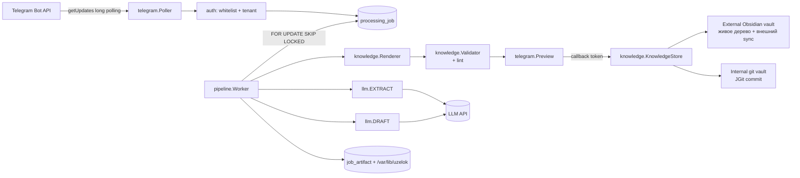

# ТЗ: Uzelok MVP

Версия 1.0 от 2026-10-30. Основано на спецификации [[Uzelok]] и протоколе консилиума
[[2026-10-30_MVP_Architecture_Review]] (6 моделей). Документ предназначен для реализации внешним
агентом-разработчиком и для ревью.

---

## 1. Цель и контекст

Uzelok — персональный сервис обучения. Пользователь присылает в Telegram материал (фото рукописного
конспекта, текст, документ) или называет тему; сервис превращает материал в структурированный
Markdown-конспект, показывает его на подтверждение и сохраняет в базу знаний в формате Obsidian-vault.
Дальнейшие этапы (интервальное повторение FSRS, RAG-поиск, проверка знаний) в этот документ не входят,
но модель данных и границы модулей оставляют для них зацепы.

**Владелец:** один разработчик-администратор, сервис разворачивается на домашнем сервере `hector`
(single-node k3s). Целевая нагрузка MVP — единицы заметок в день, до 5–10 пользователей в перспективе.

**Что считается успехом MVP:** с телефона отправлен материал, пользователь нажал «Сохранить», и через
несколько секунд в базе знаний появился валидный Markdown-файл, который проходит линтер хранилища и
автоматически коммитится в git. Без ручной правки YAML, без второй копии того же файла.

---

## 2. Границы

### Входит в MVP

- Telegram-бот (Long Polling): текст, фото, документ `.txt`/`.md`, выбор базы знаний.
- Распознавание рукописного и печатного текста с фото, выделение тезисов.
- Генерация конспекта по теме на основе тезисов.
- Превью в Telegram и подтверждение человеком (сохранить / перегенерировать / в inbox / отмена).
- Сохранение в одну из двух баз: внешняя Obsidian-база пользователя (git-репозиторий с контрактом)
  либо внутренняя база, созданная сервисом (тот же контракт).
- Изоляция пользователей (`tenant`), белый список `chatId`.
- Идемпотентность: повторная доставка апдейта/рестарт пода не создаёт дублей и не оплачивает OCR дважды.
- Журнал LLM-вызовов со стоимостью, аудит действий, лимиты и дневной бюджет.

### Не входит в MVP

- FSRS, карточки, сессии повторения, проверка знаний (следующий этап).
- RAG, эмбеддинги, семантический поиск, `[[WikiLinks]]` по вектору.
- Голосовые сообщения (нужен отдельный шаг ASR), видео, PDF-разбор, архивы.
- Собственный редактор заметок, веб-интерфейс, десктоп-клиент, мобильное приложение.
- Kafka, Transactional Outbox, второй потребитель событий.
- OIDC/Zitadel, роли, шаринг баз между пользователями.
- Отдельный dev/prod-контур в кластере, второй кластер, ingress.
- Автообновление существующих заметок и hub-конспектов темы, автоматическое создание папок таксономии.

---

## 3. Роли и сценарии

**Акторы:** пользователь (владелец базы знаний), сервис (бот), внешние системы: Telegram Bot API,
LLM-провайдер (OpenAI-совместимый API), git-репозиторий базы знаний.

### UC-1. Первый запуск и онбординг

1. Пользователь пишет боту с `chatId`, которого нет в белом списке → бот отвечает «доступ не выдан»
   и ничего не создаёт (в лог пишется попытка, в БД ничего).
2. Владелец заводит запись `app_user` + `telegram_account` вручную (SQL/миграция) — в MVP регистрация
   не автоматизирована.
3. Первое сообщение разрешённого пользователя без базы знаний → бот предлагает:
   `[Подключить мою базу]` `[Создать новую]`.
4. «Создать новую» → сервис создаёт внутреннюю базу из шаблона (структура `40_Knowledge/`, `_meta/`),
   `git init`, первый коммит, отвечает путём и названием базы.
5. «Подключить мою базу» → бот просит абсолютный путь к локальной копии vault; сервис проверяет контракт
   (наличие `40_Knowledge/`, `_meta/taxonomy.yaml`, `_meta/CONTRACT.md`) и регистрирует базу либо
   отказывает с перечнем нарушений.

### UC-2. Фото конспекта → заметка

1. Пользователь присылает одно или несколько фото (альбом).
2. Бот отвечает сообщением-статусом «Принял, распознаю…» (одно сообщение, дальше редактируется).
3. Сервис скачивает файлы, считает `sha256`, сохраняет во временный каталог, создаёт `source_item`
   + `processing_job` в состоянии `RECEIVED`.
4. Шаг `EXTRACT`: vision-модель возвращает structured output — транскрипцию, тезисы, список неразборчивых
   фрагментов, оценку уверенности. Артефакт `EXTRACTION` пишется в БД и на диск.
5. Если неразборчивых фрагментов больше порога или уверенность ниже порога — бот показывает их списком
   с кнопками `[Продолжить как есть]` `[Отправить фото заново]` `[Отмена]`.
6. Шаг `DRAFT`: текстовая модель получает тезисы + словарь тем + список существующих имён файлов и
   возвращает `{title, type, topic, summary, body_md, confidence}`.
7. Шаг `RENDER`: детерминированный код собирает frontmatter, имя файла, путь; проверяет тему по словарю,
   уникальность имени по git-индексу базы, прогоняет линтер на временной копии.
8. Бот отправляет превью: путь, тема, первые ~1500 символов и кнопки
   `[✅ Сохранить]` `[🔄 Перегенерировать]` `[📥 В _Inbox]` `[❌ Отмена]`.
9. «Сохранить» → `WRITING`: атомарная запись файла, коммит (для внутренней базы) либо ожидание внешнего
   sync-таймера (для внешней), запись `note` + `note_version`, ссылка на файл в чат.
10. «Перегенерировать» → повтор шага `DRAFT` без повторного `EXTRACT`.

### UC-3. Текст/документ → заметка

То же, что UC-2, но без шага распознавания: `EXTRACT` получает текст сообщения или содержимое файла
и сразу возвращает тезисы. Далее `DRAFT` → `RENDER` → превью → запись.

### UC-4. Тема без материала

Пользователь пишет `/topic <название>` либо отправляет сообщение с явной пометкой темы.
Сервис строит конспект по названию темы **на основе уже существующих заметок этой темы** (передаёт их
в контекст). Если заметок нет — бот предупреждает, что конспект будет сгенерирован «с нуля», и требует
явного подтверждения перед генерацией.

### UC-5. Ошибка и повтор

Любой шаг при исчерпании попыток → `FAILED` с `failed_stage` и `error_message`. В чат приходит сообщение
с кнопкой `[🔄 Повторить]`, повтор выполняется с последнего успешного шага; уже оплаченные артефакты
(`EXTRACTION`) переиспользуются.

---

## 4. Функциональные требования

Нумерация обязательна для трассировки в тестах.

### Приём и авторизация

- **FR-1.** Бот работает только в режиме Long Polling; webhook не включается, входящие порты не открываются.
- **FR-2.** Каждый апдейт и каждый callback проверяются: `chatId` в белом списке, `from.id` разрешён,
  объект (`job`, `note`), к которому относится действие, принадлежит тенанту этого чата. Иначе — отказ,
  запись в `audit_event`, ответа пользователю нет (кроме случая «доступ не выдан» для нового чата).
- **FR-3.** Апдейт дедуплицируется по `telegram_update.update_id`; сообщение — по
  `UNIQUE(chat_id, telegram_message_id)`. Повторная доставка возвращает существующий job, а не создаёт новый.
- **FR-4.** Принимаемые входы: текст (до 8000 символов), фото (JPEG/PNG/WebP, до 15 МБ на файл),
  документ `.txt`/`.md` до 1 МБ. Всё остальное отклоняется вежливым сообщением с причиной.
  Проверка MIME — по содержимому (magic bytes), не по расширению; размер проверяется до скачивания.
- **FR-5.** Альбом (несколько фото с общим `media_group_id`) склеивается в один job: обработка стартует
  не раньше чем через 1.5 с после последнего апдейта группы.

### Обработка

- **FR-6.** Job проходит состояния `RECEIVED → EXTRACTING → AWAITING_TRANSCRIPT (опционально) → DRAFTING →
  AWAITING_CONFIRM → WRITING → DONE`, а также `REJECTED`, `CANCELLED`, `FAILED`. Переходы — только через
  сервисный слой с проверкой текущего состояния (`UPDATE … WHERE status = :expected`); прямое обновление
  статуса из репозитория запрещено.
- **FR-7.** Шаги выполняются воркером, который забирает задачи из таблицы `processing_job`
  (`SELECT … FOR UPDATE SKIP LOCKED`), с lease-таймаутом: job, висящий в промежуточном статусе дольше
  10 минут, возвращается в очередь.
- **FR-8.** Каждый шаг сохраняет результат в `job_artifact` до перехода к следующему шагу. Повторный запуск
  job не выполняет шаг, у которого есть артефакт, кроме случая явной перегенерации.
- **FR-9.** Вызов LLM идемпотентен по `request_key = sha256(вход + model + prompt_version)`; при наличии
  успешного `llm_call` с тем же ключом повторный вызов не выполняется, используется сохранённый ответ.
- **FR-10.** Изображения и промежуточные артефакты хранятся на диске (`/var/lib/uzelok/artifacts/...`),
  в БД — путь, хеш и метаданные. Бинарные данные в БД не пишутся.

### Генерация

- **FR-11.** Распознавание и выделение тезисов — один вызов vision-модели для фото. Тезисы не являются
  отдельным шагом пайплайна, они часть structured output шага `EXTRACT`.
- **FR-12.** Конспект генерируется вторым вызовом модели для фото и первым для текста. Модель обязана
  вернуть structured output строго по схеме раздела 8; свободный текст как контракт не принимается.
- **FR-13.** Frontmatter, имя файла, путь и `id` формирует код, а не модель. Модель предлагает `title`,
  `type`, `topic`, `summary`, `body_md`, `confidence`. `topic` валидируется по словарю базы; отсутствие
  темы в словаре → путь `_Inbox` либо отказ (см. FR-15).
- **FR-14.** Детерминированные правила рендера: имя файла `Title_Case_With_Underscores` (только
  `[A-Za-z0-9_]`, латиница; при кириллическом заголовке — транслитерация), длина ≤ 80 символов; путь
  `<domain-folder>/<topic-folder>/<Name>.md` по словарю; коллизия имени — не автосуффикс, а перевод в
  `_Inbox` с пометкой в превью.
- **FR-15.** Проверки перед записью: тема есть в словаре, имя уникально (по `git ls-files` базы, не по
  файловой системе), frontmatter валиден, линтер базы проходит на временной копии. Любая неуспешная
  проверка → job остаётся в `AWAITING_CONFIRM` с блокирующей причиной в превью; запись запрещена.

### Подтверждение и запись

- **FR-16.** Превью редактируется как одно сообщение-статус (не более одной правки в 2 секунды).
  Если тело конспекта длиннее 3500 символов, оно отправляется документом `.md`, а в сообщении остаётся
  путь, тема и краткое summary.
- **FR-17.** Кнопки передают непрозрачный одноразовый токен (`pending_action.token`), а не `job_id`
  и не путь; токен привязан к `chat_id`, сообщению, job и имеет срок жизни 24 часа.
- **FR-18.** Запись файла атомарна: `.tmp` в том же каталоге + `ATOMIC_MOVE`. Для внутренней базы после
  записи — коммит с сообщением `note: <Title> (<job-id>)` и трейлером `Uzelok-Job: <uuid>`; повтор с тем же
  `content_hash` коммит не создаёт.
- **FR-19.** Для внешней базы сервис не делает `git commit` и не вызывает `git pull` — только пишет файл
  в рабочее дерево; коммит и push выполняет внешний процесс синхронизации. Сервис обязан использовать
  блокировку записи в пределах своей базы (`SELECT … FOR UPDATE` по строке `knowledge_base`).
- **FR-20.** После `DONE` в чат приходит подтверждение с относительным путём файла и темой; в `audit_event`
  пишется `note_saved` с `note_id`, хешем и (если есть) commit sha.

### Служебное

- **FR-21.** `/start`, `/help` — краткая инструкция; `/ai_mode` — показать текущий профиль моделей;
  `/stats` — количество заметок, потраченные центы за 24 часа и за месяц; `/cancel` — отменить активный job.
- **FR-22.** Дневной бюджет: при превышении `uzelok.llm.daily-budget-usd` новые генерации блокируются,
  пользователь получает сообщение, событие пишется в `audit_event`.
- **FR-23.** Все действия `confirm`, `reject`, `regenerate`, `write`, `failure`, `auth_denied` фиксируются
  в `audit_event` с `tenant_id`, `chat_id`, `job_id`.

---

## 5. Нефункциональные требования

- **NFR-1. Ресурсы.** Один под: лимит 1536 MiB памяти, `-XX:MaxRAMPercentage=70`, CPU limit 1.0.
  HTTP-сервер не поднимается (`spring.main.web-application-type=none`), входящих соединений нет.
- **NFR-2. Задержка.** Текстовая заметка — до 30 с от подтверждения до файла; фото — до 90 с до превью.
  Ожидание LLM не блокирует поток опроса Telegram.
- **NFR-3. Стоимость.** Одна заметка ≤ $0.05 при списании по тарифу провайдера; стоимость каждого вызова
  фиксируется в `llm_call`.
- **NFR-4. Надёжность.** Рестарт пода в любом состоянии не теряет job и не создаёт дубль заметки.
  Повторный `kill -9` посреди шага — тот же инвариант.
- **NFR-5. Приватность.** Содержимое конспектов и фото не пишутся в логи и не уходят никуда, кроме
  выбранного LLM-провайдера и базы знаний пользователя. Логи содержат только идентификаторы, статусы,
  длительности, токены и стоимость.
- **NFR-6. Секреты.** Только в Kubernetes Secret → переменные окружения. В репозитории, БД, логах и
  в ответах бота секретов нет.
- **NFR-7. Совместимость.** Файлы базы остаются валидными для Obsidian и для линтера базы; сервис не
  меняет существующие файлы и не удаляет их.
- **NFR-8. Наблюдаемость.** Структурированные логи (JSON) с полями `job_id`, `step`, `tenant`,
  `duration_ms`; метрики не обязательны. OTel-экспорт в Arize Phoenix — за флагом `uzelok.otel.enabled`
  (по умолчанию выключен в MVP).

---

## 6. Архитектура

### 6.1. Компоненты



Сервис — **один деплой-юнит**, один процесс, без брокера сообщений. Состояние — в PostgreSQL,
контент — в файлах базы знаний.

### 6.2. Принятые решения и их причины

| Решение | Причина |
| :--- | :--- |
| Модульный монолит в одном Gradle-модуле, границы через пакеты + ArchUnit | 7 build-файлов на соло-проект дороже выгоды; границы проверяются тестом, а не сборкой |
| Очередь в Postgres (`processing_job` + `SKIP LOCKED`) вместо Kafka | Один потребитель, шаги секундные; брокер не даёт ничего, кроме RAM и конфигурации |
| Long Polling вместо webhook | Нет входящих портов и публичного URL |
| Frontmatter/путь/имя — код, не модель | Модель ломает YAML и может выбрать путь вне контракта; это дыра, а не деталь промпта |
| Порт `KnowledgeStore` с двумя адаптерами | Пользователь либо подключает свою базу, либо получает созданную сервисом с тем же контрактом |
| Внешняя база — без git-клиента в приложении | Второй git-писатель в тот же репозиторий конкурирует с существующим sync-процессом |
| Stateless-LLM: только structured output, без инструментов | Исключает prompt injection в действия (запись, удаление, shell) |
| Один PostgreSQL на все тенанты, `tenant_id` в каждой таблице | Flyway и бэкап — одни на всех; до 10 пользователей этого достаточно |

### 6.3. Технологический стек (проверено на Maven Central / Gradle Plugin Portal)

| Компонент | Версия |
| :--- | :--- |
| Java | 25 (LTS), toolchain в Gradle |
| Spring Boot | 4.1.2 |
| Spring AI | 2.0.2 (`spring-ai-starter-model-openai`, `spring-ai-starter-model-anthropic`) |
| Telegram Bots | `org.telegram:telegrambots-longpolling` + `telegrambots-client` 10.3.0 |
| PostgreSQL driver | `org.postgresql:postgresql` (управляется Boot BOM) |
| Flyway | 11.x (`flyway-core`, `flyway-database-postgresql`) |
| JGit | `org.eclipse.jgit:org.eclipse.jgit` 7.3.0.202506031305-r |
| Gradle | 9.x (Kotlin DSL), Jib 3.5.4 |
| Тесты | JUnit 5, Testcontainers `postgresql` 1.21.x, ArchUnit 1.4.1 |

---

## 7. Структура приложения

Один Gradle-модуль, корневой пакет `uzelok`. Разделение по слоям и подпакетам; зависимости
направлены внутрь (`domain` не знает о Spring, HTTP, SQL и git).

```text
uzelok-ai/
├── build.gradle.kts
├── settings.gradle.kts
├── gradle/libs.versions.toml
├── gradle/wrapper/…
├── docs/
│   ├── TZ_MVP.md                       # этот документ
│   └── adr/                            # решения по мере реализации
├── deploy/k8s/
│   ├── namespace.yaml                  # ns uzelok, label purpose=application
│   ├── networkpolicy.yaml              # копия templates/app-namespace-policies.yaml
│   ├── deployment.yaml                 # replicas 1, лимиты, envFrom Secret, hostPath + PVC
│   ├── pvc.yaml                        # artifacts + внутренние базы
│   └── secret.example.yaml             # шаблон без значений
├── scripts/
│   ├── e2e-dry-run.sh                  # прогон рендера+линтера на копии базы
│   └── pg-dump.sh                      # дамп БД uzelok в /mnt/hdd/backups/uzelok
└── src/
    ├── main/
    │   ├── java/uzelok/
    │   │   ├── UzelokApplication.java
    │   │   ├── domain/
    │   │   │   ├── model/
    │   │   │   │   ├── Tenant.java
    │   │   │   │   ├── AppUser.java
    │   │   │   │   ├── KnowledgeBase.java          # id, kind, rootPath, taxonomyRelPath, inboxRelPath
    │   │   │   │   ├── KnowledgeBaseKind.java      # EXTERNAL_OBSIDIAN | INTERNAL_GIT
    │   │   │   │   ├── SourceItem.java
    │   │   │   │   ├── ProcessingJob.java
    │   │   │   │   ├── JobStatus.java              # enum состояний из FR-6
    │   │   │   │   ├── JobArtifact.java
    │   │   │   │   ├── ArtifactKind.java           # ORIGINAL | EXTRACTION | DRAFT_JSON | RENDERED_MD | LINT_REPORT
    │   │   │   │   ├── NoteDraft.java              # title, type, topic, summary, bodyMd, confidence
    │   │   │   │   ├── RenderedNote.java           # relPath, fileName, frontmatter, markdown, hash
    │   │   │   │   ├── Note.java
    │   │   │   │   ├── Taxonomy.java               # domains → topics, folder(), topicFolder()
    │   │   │   │   ├── TopicRef.java
    │   │   │   │   └── NoteType.java               # concept | problem | source_note | research | snippet | protocol
    │   │   │   ├── port/
    │   │   │   │   ├── KnowledgeStore.java         # prepare(draft) → RenderedNote | violations; write(note)
    │   │   │   │   ├── TaxonomyReader.java
    │   │   │   │   ├── VaultLinter.java            # exit code + отчёт
    │   │   │   │   ├── LlmGateway.java             # extract(...), draft(...)
    │   │   │   │   ├── TelegramGateway.java        # send/edit/download/callback
    │   │   │   │   ├── JobRepository.java
    │   │   │   │   ├── SourceItemRepository.java
    │   │   │   │   ├── NoteRepository.java
    │   │   │   │   ├── TenantRepository.java
    │   │   │   │   ├── AuditRepository.java
    │   │   │   │   └── Clock.java
    │   │   │   └── exception/
    │   │   │       ├── DomainException.java
    │   │   │       ├── IllegalStateTransition.java
    │   │   │       ├── ContractViolation.java      # тема/имя/линтер
    │   │   │       └── QuotaExceeded.java
    │   │   ├── pipeline/
    │   │   │   ├── JobService.java                 # создание job, переходы, отмена
    │   │   │   ├── JobWorker.java                  # @Scheduled: забор задач, шаги, retry/backoff
    │   │   │   ├── JobStateMachine.java            # разрешённые переходы
    │   │   │   ├── step/ExtractStep.java
    │   │   │   ├── step/DraftStep.java
    │   │   │   ├── step/RenderStep.java
    │   │   │   ├── step/WriteStep.java
    │   │   │   └── ArtifactService.java
    │   │   ├── knowledge/
    │   │   │   ├── NoteRenderer.java               # frontmatter + имя + путь
    │   │   │   ├── FileNamePolicy.java             # Title_Case, транслитерация, лимит длины
    │   │   │   ├── TaxonomyLoader.java             # YAML → Taxonomy
    │   │   │   ├── ContractValidator.java          # правила хранилища
    │   │   │   ├── LinterRunner.java               # вызов линтера базы (команда из конфига профиля)
    │   │   │   ├── GitIndex.java                   # ls-files по базе
    │   │   │   ├── VaultTemplate.java              # создание внутренней базы из шаблона
    │   │   │   ├── ExternalObsidianStore.java      # реализация KnowledgeStore
    │   │   │   └── InternalGitStore.java           # реализация KnowledgeStore
    │   │   ├── telegram/
    │   │   │   ├── TelegramPoller.java             # DefaultBotSession, long polling
    │   │   │   ├── UpdateRouter.java               # message | callback → handler
    │   │   │   ├── MessageHandler.java
    │   │   │   ├── CallbackHandler.java
    │   │   │   ├── MediaGroupBuffer.java
    │   │   │   ├── FileDownloader.java
    │   │   │   ├── PreviewComposer.java
    │   │   │   ├── StatusMessage.java              # throttle правок
    │   │   │   └── Keyboards.java
    │   │   ├── llm/
    │   │   │   ├── LlmRouter.java                  # выбор модели по шагу и профилю
    │   │   │   ├── ExtractionClient.java           # vision: транскрипция + тезисы
    │   │   │   ├── DraftClient.java                # structured draft
    │   │   │   ├── StructuredSchemas.java          # JSON-схемы (раздел 8)
    │   │   │   ├── PromptCatalog.java              # версии промптов из resources/prompts
    │   │   │   └── LlmUsageRecorder.java
    │   │   ├── persistence/
    │   │   │   ├── JdbcJobRepository.java
    │   │   │   ├── JdbcSourceItemRepository.java
    │   │   │   ├── JdbcNoteRepository.java
    │   │   │   ├── JdbcTenantRepository.java
    │   │   │   ├── JdbcTaxonomyReader.java
    │   │   │   ├── JdbcAuditRepository.java
    │   │   │   └── JdbcLlmCallRepository.java
    │   │   └── config/
    │   │       ├── UzelokProperties.java           # @ConfigurationProperties("uzelok")
    │   │       ├── TelegramConfig.java
    │   │       ├── LlmConfig.java
    │   │       ├── SchedulingConfig.java
    │   │       ├── ClockConfig.java
    │   │       └── SecurityConfig.java             # whitelist + tenant resolution
    │   └── resources/
    │       ├── application.yml
    │       ├── db/migration/V1__init.sql
    │       ├── prompts/extract-v1.md
    │       ├── prompts/draft-v1.md
    │       ├── strings/ru.properties               # тексты бота
    │       └── vault-template/
    │           ├── 40_Knowledge/_meta/CONTRACT.md
    │           ├── 40_Knowledge/_meta/taxonomy.yaml
    │           └── 40_Knowledge/_Inbox/.gitkeep
    └── test/java/uzelok/
        ├── architecture/LayerRulesTest.java         # ArchUnit: правила зависимостей
        ├── knowledge/NoteRendererTest.java
        ├── knowledge/FileNamePolicyTest.java
        ├── knowledge/TaxonomyLoaderTest.java
        ├── knowledge/ContractValidatorTest.java
        ├── knowledge/ExternalObsidianStoreTest.java # пишет во временную копию vault
        ├── knowledge/InternalGitStoreTest.java      # JGit-коммит, идемпотентность
        ├── pipeline/JobStateMachineTest.java
        ├── pipeline/JobWorkerResumeTest.java        # Testcontainers: рестарт посреди шага
        ├── llm/StructuredOutputTest.java            # схемы и парсинг ответов (fixtures)
        └── telegram/UpdateRouterTest.java           # дедуп, whitelist, чужие callback
```

### 7.1. Правила зависимостей (проверяются ArchUnit)

1. `domain` не зависит ни от чего, кроме JDK.
2. `pipeline` зависит только от `domain` (+ JDK); не импортирует `telegram`, `llm`, `persistence`, `knowledge`.
3. `telegram`, `llm`, `knowledge`, `persistence` зависят от `domain`; друг друга не импортируют.
4. `config` может зависеть от всех; ни один пакет, кроме `config`, не импортирует `org.springframework.boot.context.properties`.
5. Классы с `@Scheduled`/`@Component` живут только в `pipeline`, `telegram`, `llm`, `knowledge`, `config`.
6. Ни один класс вне `persistence` не импортирует `org.springframework.jdbc`/`jakarta.persistence`.
7. Ни один класс вне `llm`/`telegram` не вызывает HTTP-клиенты напрямую.

### 7.2. Ключевые интерфейсы

```java
public interface KnowledgeStore {
    PreparedNote prepare(NoteDraft draft, boolean forceInbox) throws ContractViolation;
    WrittenNote write(PreparedNote note) throws ContractViolation;
}

public record PreparedNote(
        String relPath, String fileName, String markdown,
        String contentHash, List<String> warnings) {}

public interface LlmGateway {
    Extraction extract(List<Path> images, String text, String modelId, String promptVersion);
    NoteDraft draft(Extraction extraction, Taxonomy taxonomy, List<String> existingNames,
                    String modelId, String promptVersion);
}

public record Extraction(String transcript, List<Thesis> theses,
                         List<String> unclearSpans, double confidence) {}
public record Thesis(String text, double confidence) {}
```

---

## 8. Контракты с LLM

### 8.1. Шаг EXTRACT (vision, только фото)

Вход: изображение(-я) + инструкция. Выход строго по схеме:

```json
{
  "transcript": "полный текст с сохранением структуры: заголовки, списки, формулы, нумерация",
  "theses": [{"text": "тезис одной фразой", "confidence": 0.0}],
  "unclear_spans": ["фрагменты, которые не удалось прочитать"],
  "confidence": 0.0
}
```

Требования к промпту: транскрипция дословная, без пересказа и без «улучшения» формулировок; нечитаемое
помечать `[неразборчиво: ...]` и дублировать в `unclear_spans`; формулы в LaTeX; сохранять пометки и
стрелки как текст; не добавлять ничего от себя.

### 8.2. Шаг DRAFT

Вход: тезисы, транскрипция, словарь тем (список `domain / topic / keywords`), список существующих имён
файлов темы. Выход:

```json
{
  "title": "Заголовок заметки без спецсимволов",
  "type": "concept",
  "topic": "two_pointers",
  "summary": "одно предложение до 150 символов",
  "body_md": "тело заметки в Markdown без frontmatter",
  "confidence": 0.0
}
```

Требования: `topic` — только из переданного словаря (иначе `unknown`); тело — структурированный конспект
(заголовки `##`, списки, при необходимости таблицы и формулы), без frontmatter; ссылки на существующие
заметки — только из переданного списка имён, в формате `[[Name]]`; язык — русский, термины — в оригинале.

---

## 9. Модель данных (Flyway `V1__init.sql`)

```sql
CREATE EXTENSION IF NOT EXISTS pgcrypto;

CREATE TABLE tenant (
    id          uuid PRIMARY KEY DEFAULT gen_random_uuid(),
    slug        text NOT NULL UNIQUE,
    name        text NOT NULL,
    created_at  timestamptz NOT NULL DEFAULT now()
);

CREATE TABLE app_user (
    id                uuid PRIMARY KEY DEFAULT gen_random_uuid(),
    tenant_id         uuid NOT NULL REFERENCES tenant(id),
    telegram_user_id  bigint NOT NULL UNIQUE,
    display_name      text,
    created_at        timestamptz NOT NULL DEFAULT now()
);

CREATE TABLE telegram_account (
    chat_id     bigint PRIMARY KEY,
    user_id     uuid NOT NULL REFERENCES app_user(id),
    tenant_id   uuid NOT NULL REFERENCES tenant(id),
    allowed     boolean NOT NULL DEFAULT false,
    created_at  timestamptz NOT NULL DEFAULT now()
);

CREATE TABLE knowledge_base (
    id                uuid PRIMARY KEY DEFAULT gen_random_uuid(),
    tenant_id         uuid NOT NULL REFERENCES tenant(id),
    kind              text NOT NULL CHECK (kind IN ('EXTERNAL_OBSIDIAN','INTERNAL_GIT')),
    root_path         text NOT NULL,
    git_remote        text,
    branch            text,
    taxonomy_relpath  text NOT NULL DEFAULT '40_Knowledge/_meta/taxonomy.yaml',
    inbox_relpath     text NOT NULL DEFAULT '40_Knowledge/_Inbox',
    active            boolean NOT NULL DEFAULT true,
    created_at        timestamptz NOT NULL DEFAULT now(),
    UNIQUE (tenant_id)
);

CREATE TABLE telegram_update (
    update_id    bigint PRIMARY KEY,
    chat_id      bigint,
    update_type  text NOT NULL,
    received_at  timestamptz NOT NULL DEFAULT now()
);

CREATE TABLE source_item (
    id                   uuid PRIMARY KEY DEFAULT gen_random_uuid(),
    tenant_id            uuid NOT NULL REFERENCES tenant(id),
    knowledge_base_id    uuid NOT NULL REFERENCES knowledge_base(id),
    chat_id              bigint NOT NULL,
    telegram_message_id  bigint NOT NULL,
    kind                 text NOT NULL CHECK (kind IN ('TEXT','PHOTO','DOCUMENT','TOPIC')),
    text_body            text,
    telegram_file_id     text,
    file_path            text,
    mime                 text,
    byte_size            bigint,
    sha256               text,
    created_at           timestamptz NOT NULL DEFAULT now(),
    UNIQUE (chat_id, telegram_message_id)
);

CREATE TABLE processing_job (
    id                 uuid PRIMARY KEY DEFAULT gen_random_uuid(),
    tenant_id          uuid NOT NULL REFERENCES tenant(id),
    source_item_id     uuid NOT NULL UNIQUE REFERENCES source_item(id),
    knowledge_base_id  uuid NOT NULL REFERENCES knowledge_base(id),
    status             text NOT NULL,
    failed_stage       text,
    attempt_count      int NOT NULL DEFAULT 0,
    next_run_at        timestamptz NOT NULL DEFAULT now(),
    lease_until        timestamptz,
    status_message_id  bigint,
    error_code         text,
    error_message      text,
    confirmed_at       timestamptz,
    created_at         timestamptz NOT NULL DEFAULT now(),
    updated_at         timestamptz NOT NULL DEFAULT now(),
    CHECK (status IN ('RECEIVED','EXTRACTING','AWAITING_TRANSCRIPT','DRAFTING',
                      'AWAITING_CONFIRM','WRITING','DONE','REJECTED','CANCELLED','FAILED'))
);

CREATE INDEX processing_job_queue_idx ON processing_job (status, next_run_at);

CREATE TABLE job_artifact (
    id              uuid PRIMARY KEY DEFAULT gen_random_uuid(),
    job_id          uuid NOT NULL REFERENCES processing_job(id) ON DELETE CASCADE,
    tenant_id       uuid NOT NULL REFERENCES tenant(id),
    kind            text NOT NULL CHECK (kind IN ('ORIGINAL','EXTRACTION','DRAFT_JSON','RENDERED_MD','LINT_REPORT')),
    version         int NOT NULL DEFAULT 1,
    sha256          text,
    storage_path    text,
    inline_text     text,
    model           text,
    prompt_version  text,
    created_at      timestamptz NOT NULL DEFAULT now(),
    UNIQUE (job_id, kind, version)
);

CREATE TABLE note (
    id                 uuid PRIMARY KEY,
    tenant_id          uuid NOT NULL REFERENCES tenant(id),
    knowledge_base_id  uuid NOT NULL REFERENCES knowledge_base(id),
    job_id             uuid REFERENCES processing_job(id),
    type               text NOT NULL,
    title              text NOT NULL,
    domain             text,
    topic              text,
    file_name          text NOT NULL,
    rel_path           text NOT NULL,
    content_hash       text NOT NULL,
    git_commit_sha     text,
    created_at         timestamptz NOT NULL DEFAULT now(),
    updated_at         timestamptz NOT NULL DEFAULT now(),
    UNIQUE (knowledge_base_id, file_name)
);

CREATE TABLE note_version (
    id             uuid PRIMARY KEY DEFAULT gen_random_uuid(),
    note_id        uuid NOT NULL REFERENCES note(id) ON DELETE CASCADE,
    version_no     int NOT NULL,
    markdown       text NOT NULL,
    content_hash   text NOT NULL,
    created_at     timestamptz NOT NULL DEFAULT now(),
    UNIQUE (note_id, version_no)
);

CREATE TABLE llm_call (
    id                uuid PRIMARY KEY DEFAULT gen_random_uuid(),
    tenant_id         uuid NOT NULL REFERENCES tenant(id),
    job_id            uuid REFERENCES processing_job(id),
    step              text NOT NULL CHECK (step IN ('EXTRACT','DRAFT','REGENERATE')),
    provider          text NOT NULL,
    model             text NOT NULL,
    prompt_version    text NOT NULL,
    request_key       text NOT NULL UNIQUE,
    input_tokens      int,
    output_tokens     int,
    cost_usd          numeric(10,6),
    latency_ms        int,
    status            text NOT NULL CHECK (status IN ('SUCCESS','FAILED')),
    created_at        timestamptz NOT NULL DEFAULT now()
);

CREATE TABLE pending_action (
    token       text PRIMARY KEY,
    job_id      uuid NOT NULL REFERENCES processing_job(id) ON DELETE CASCADE,
    tenant_id   uuid NOT NULL REFERENCES tenant(id),
    action      text NOT NULL CHECK (action IN ('SAVE','REGENERATE','INBOX','CANCEL','RETRY','CONTINUE_OCR')),
    chat_id     bigint NOT NULL,
    message_id  bigint,
    expires_at  timestamptz NOT NULL,
    used_at     timestamptz
);

CREATE TABLE audit_event (
    id           bigserial PRIMARY KEY,
    tenant_id    uuid REFERENCES tenant(id),
    chat_id      bigint,
    action       text NOT NULL,
    entity_type  text,
    entity_id    uuid,
    detail       jsonb,
    created_at   timestamptz NOT NULL DEFAULT now()
);

-- Начальные данные для владельца (заполнить при деплое, не в миграции схемы)
-- INSERT INTO tenant (slug, name) VALUES ('roman', 'Roman');
-- INSERT INTO app_user (tenant_id, telegram_user_id, display_name) …
-- INSERT INTO telegram_account (chat_id, user_id, tenant_id, allowed) …
```

Заделы на будущее, **не создавать в MVP**: `review_card` (FSRS), `note_chunk` + `embedding vector(N)` (RAG).
Задел фактический: `note.id` (тот же UUID пишется во frontmatter) и артефакт `EXTRACTION` с тезисами.

---

## 10. Контракт базы знаний

### 10.1. Структура

```text
<root>/
└── 40_Knowledge/
    ├── _meta/
    │   ├── CONTRACT.md
    │   └── taxonomy.yaml
    ├── _Inbox/
    └── <Domain>/<Topic>/<Title_Case_Name>.md
```

### 10.2. Frontmatter заметки, которую создаёт сервис

```yaml
---
type: concept            # concept | problem | source_note
topic: two_pointers      # тема из taxonomy.yaml
status: raw              # всегда raw для новых
source: telegram         # telegram | lecture | book | article | thought
id: 0192f3c4-...         # UUID, генерирует сервис
created: 2026-10-30
updated: 2026-10-30
summary: "одно предложение до 150 символов"
---
```

Поля `topics`, `derived_from`, `problem_*` сервис не заполняет.

### 10.3. Правила

1. Тема из словаря → папка `<domain>/<topic>` строго как в `taxonomy.yaml`; новых папок сервис не создаёт.
2. Имя файла: латиница `Title_Case_With_Underscores`, ≤ 80 символов, уникально по всей базе (проверка
   по `git ls-files`).
3. Тема не найдена или уверенность модели ниже порога → `_Inbox/<Name>.md` (если имя занято — отказ).
4. Отказ от записи вместо «умного» доисправления: любые сомнения показываются пользователю.
5. Линтер базы прогоняется на временной копии каталога до записи; код возврата ≠ 0 → запись запрещена,
   пользователю показывается причина.
6. Существующие файлы не изменяются и не удаляются. Внешняя база: сервис только добавляет файл.

---

## 11. Состояния и идемпотентность

| Из | В | Условие |
| :--- | :--- | :--- |
| RECEIVED | EXTRACTING | job забран воркером, есть входные данные |
| EXTRACTING | AWAITING_TRANSCRIPT | есть `unclear_spans` сверх порога |
| EXTRACTING | DRAFTING | артефакт EXTRACTION сохранён |
| AWAITING_TRANSCRIPT | DRAFTING | пользователь нажал «Продолжить» или прислал исправление |
| DRAFTING | AWAITING_CONFIRM | артефакты DRAFT_JSON и RENDERED_MD сохранены, проверки пройдены |
| AWAITING_CONFIRM | DRAFTING | «Перегенерировать» (новый prompt_version) |
| AWAITING_CONFIRM | WRITING | «Сохранить» (или «В _Inbox» → флаг forceInbox) |
| AWAITING_CONFIRM | REJECTED / CANCELLED | «Отмена» |
| WRITING | DONE | файл записан, `note` + `note_version` созданы |
| WRITING | FAILED | ошибка записи/коммита после 3 попыток |
| любое | FAILED | ошибка шага после 3 попыток (с `failed_stage`) |
| FAILED | <failed_stage> | «Повторить» (не более 3 повторов на шаг) |

Инварианты:

- Один `source_item` → один `processing_job` (`UNIQUE(source_item_id)`).
- Один `note.id` ↔ один файл; повторная запись с тем же `content_hash` — no-op.
- `llm_call.request_key` уникален: `sha256(step|input_sha256|model|prompt_version)`.
- Переход статуса — `UPDATE processing_job SET status = :to WHERE id = :id AND status = :from`;
  0 строк → переход отклонён (конкурентный обработчик уже сдвинул состояние).
- Lease: воркер ставит `lease_until = now() + 10 min`; задача с истёкшим lease и промежуточным статусом
  возвращается в очередь с `attempt_count + 1`.

---

## 12. Безопасность

- **Аутентификация:** белый список `chatId` (`telegram_account.allowed`) + проверка `from.id`.
  Отдельный `TenantContext`, получаемый только из `chat_id` апдейта; ручная передача `tenant_id` из
  бизнес-кода запрещена.
- **Авторизация действия:** callback-токен из `pending_action` проверяется на `chat_id`, `job_id`, срок
  жизни и одноразовость; повторное нажатие отклоняется.
- **Вход:** magic bytes + MIME allowlist, лимиты размера, лимит пикселей изображения (≤ 30 Мп), отказ от
  архивов и исполняемых файлов; загруженные файлы удаляются после `DONE`/`FAILED` (TTL 72 ч).
- **LLM:** без инструментов, без сети, только structured output; входные данные считаются недоверенными,
  инструкции из материала не выполняются.
- **Пути:** итоговый путь строится только из словаря; результат проверяется `Path.normalize()` и
  `startsWith(rootPath)`; символы `..` и `/` в именах запрещены.
- **Квоты:** не более 20 job на чат в сутки, 5 в час; дневной бюджет LLM (`uzelok.llm.daily-budget-usd`),
  при превышении — отказ, не ретрай.
- **Секреты:** Kubernetes Secret → env; в логах фильтр по известным именам переменных; ответы бота
  никогда не содержат токенов и ключей.
- Вне области MVP (осознанно): OIDC, шифрование полей в БД, HMAC для callback, ротация ключей по календарю.

---

## 13. Конфигурация и деплой

### 13.1. `application.yml` (ключевые параметры)

```yaml
spring:
  main:
    web-application-type: none
  datasource:
    url: ${UZELOK_DB_URL}
    username: ${UZELOK_DB_USER}
    password: ${UZELOK_DB_PASSWORD}
  flyway:
    enabled: true
uzelok:
  telegram:
    bot-token: ${UZELOK_BOT_TOKEN}
    bot-username: ${UZELOK_BOT_USERNAME}
    poll-timeout-seconds: 30
    media-group-window-ms: 1500
  llm:
    provider: openrouter            # openrouter | opencode-go
    base-url: ${UZELOK_LLM_BASE_URL}
    api-key: ${UZELOK_LLM_API_KEY}
    vision-model: claude-haiku-5-5
    vision-fallback-model: gemini-4-argon
    text-model: deepseek-v4.1-flash
    prompt-version: v1
    daily-budget-usd: 2.00
    timeout-seconds: 120
  knowledge:
    lint-command: /home/roman/.hermes/scripts/agora_lint.py
    lint-timeout-seconds: 60
    confidence-threshold: 0.55
    max-title-length: 80
  worker:
    lease-minutes: 10
    max-attempts: 3
    poll-interval-ms: 2000
  otel:
    enabled: false
```

### 13.2. Окружение

- PostgreSQL `postgres.infra-shared.svc.cluster.local:5432`, база `uzelok`, роль `uzelok_app`
  (права только на свою БД). БД `uzelok_dev` — для локальной разработки.
- k3s: namespace `uzelok` с лейблом `purpose=application` (доступ к Postgres 5432 разрешён политикой
  `infra-shared`), NetworkPolicy из шаблона (исходящий интернет разрешён, LAN/Tailscale вырезаны).
- Монтирования: `hostPath` на каталог внешней базы (rw) — только для тенанта владельца; PVC 5 Gi на
  `/var/lib/uzelok` (артефакты + внутренние базы).
- Deployment: `replicas: 1` (второй под ломает `getUpdates` — 409), `runAsUser: 1000`, `fsGroup: 1000`,
  лимит памяти 1536 Mi, CPU 1.
- Бэкапы: `pg_dump uzelok` по cron в `/mnt/hdd/backups/uzelok/`, хранение 7 дней; бэкап внутренних баз —
  обычный tar каталога (они git-репозитории).

---

## 14. Ошибки и наблюдаемость

- Каждый шаг обёрнут в обработчик ошибок: технические (сеть, 5xx, таймаут) — ретрай с backoff
  (5 с, 30 с, 2 мин), затем `FAILED`; доменные (`ContractViolation`, `QuotaExceeded`) — без ретрая.
- В лог: `job_id`, `step`, `status`, `duration_ms`, `attempt`, `error_code`; текст заметки, транскрипция
  и ответы модели в лог не попадают.
- Стоимость: запись в `llm_call` на каждый вызов, включая неуспешный (с `status = FAILED`).
- Отладочный режим `uzelok.debug.dump-artifacts=true` пишет артефакты на диск и не включает логирование
  содержимого.

---

## 15. Тестирование и критерии приёмки

### Обязательные тесты

1. `NoteRendererTest` — frontmatter, путь, имя, LaTeX/таблицы в теле не портятся.
2. `FileNamePolicyTest` — транслитерация, лимит длины, запрещённые символы, коллизии.
3. `ContractValidatorTest` — тема вне словаря, отсутствующая `_meta`, чужой контракт.
4. `ExternalObsidianStoreTest` — запись в копию реальной базы, затем запуск линтера базы: код 0.
5. `InternalGitStoreTest` — создание базы из шаблона, коммит, повторная запись того же хеша не коммитит.
6. `JobWorkerResumeTest` (Testcontainers) — падение посреди `EXTRACTING`, перезапуск, отсутствие второго
   вызова vision и второго `note`.
7. `UpdateRouterTest` — дубль `update_id`, чужой `chatId`, чужой callback, повторное нажатие кнопки.
8. `StructuredOutputTest` — фикстуры ответов моделей, включая неполный JSON и `topic` вне словаря.
9. `LayerRulesTest` (ArchUnit) — правила раздела 7.1.

### Definition of Done

1. С телефона: фото конспекта → превью → «Сохранить» → файл в базе, линтер базы зелёный, коммит есть
   (внутренняя база) либо файл подхвачен внешним sync (внешняя база).
2. То же для текстового сообщения без OCR.
3. Повторная отправка того же фото не создаёт второй файл и не делает второй vision-вызов.
4. `kill -9` пода на шагах `EXTRACTING` и `WRITING` → после старта job продолжается, дублей нет.
5. Пользователь без базы получает предложение создать её, созданная база валидна и проходит линтер.
6. Чужой `chatId` и чужой callback не приводят ни к каким действиям.
7. Стоимость заметки видна в `llm_call`; сумма за сутки не превышает бюджет.
8. 10 реальных заметок подряд без ручной правки YAML.

---

## 16. Порядок реализации

1. Каркас: Gradle, зависимости, `UzelokApplication`, Flyway `V1`, `UzelokProperties`, конфигурация
   логирования, ArchUnit-тест (может быть с пустыми правилами).
2. `knowledge`: `TaxonomyLoader`, `FileNamePolicy`, `NoteRenderer`, `ContractValidator`, `LinterRunner`,
   `ExternalObsidianStore` + тесты на копии базы. Критерий: валидный файл на копии, линтер 0.
3. `telegram`: poller, whitelist, приём текста/фото, `MediaGroupBuffer`, `StatusMessage`, дедуп апдейтов,
   создание `source_item` + `processing_job`. LLM на этом шаге — заглушка, отдающая фиктивный `NoteDraft`.
4. `llm` + `pipeline`: `ExtractionClient`, `DraftClient`, схемы, `JobWorker` со шагами и lease;
   превью, кнопки, `pending_action`, запись.
5. `InternalGitStore` и онбординг (создание базы из шаблона).
6. Деплой в k3s, `pg_dump`-cron, прогон DoD.

---

## 17. Вопросы ревьюеру (для внешнего агента)

1. Достаточно ли `UNIQUE(source_item_id)` и `request_key` для идемпотентности, или нужен ещё ключ на
   уровне «шаг + версия входа»? Где сценарий, в котором появится дубль?
2. Не противоречит ли запись во внешнюю базу без собственного коммита требованию «не сломать чужой
   репозиторий»? Какие проверки добавить, чтобы `pull --rebase` внешнего sync не упал?
3. Достаточна ли защита от prompt injection в схеме «модель не имеет инструментов, путь строит код»?
4. Не приведёт ли единый модуль к неявным связям, которые не ловит ArchUnit (общие утилиты, статические
   хелперы)? Какие правила добавить?
5. Корректна ли схема БД для будущего FSRS (`note.id` + артефакт тезисов) без отдельной таблицы карточек?
6. Что в MVP можно вырезать ещё, без потери ценности «материал → валидная заметка»?

---

## Связанные заметки

[[Uzelok]]
[[2026-10-30_MVP_Architecture_Review]]
[[UZL_Stage1_MVP_Infra_Notes_Pipeline]]
