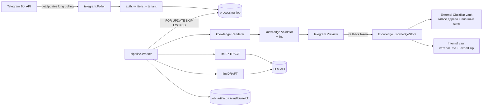

# ТЗ: Uzelok MVP

Версия 1.9 от 2026-11-03: v1.1 — разбор внешнего ревью, v1.2 — отказ от git во внутренней базе,
v1.3 — устранение оставшихся следов git, v1.4 — приведение контракта заметки к фактическому
`40_Knowledge/_meta/CONTRACT.md` v2 и порта `KnowledgeStore` (раздел 19), v1.5 — сборка бинов только
в `config` (ADR 0002) и уникальность альбома на уровне схемы, v1.6 — Spring AI удалён (ADR 0003),
v1.7 — деплой в k3s, v1.8 — границы MVP закрыты на «материал → заметка», v1.9 — внутренняя база
нейтральная (`notes/`), контракт agora только у подключённой внешней базы, git-зависимости удалены
(ADR 0006, ADR 0007). Основано на спецификации [[Uzelok]] и протоколе консилиума
[[2026-10-30_MVP_Architecture_Review]] (6 моделей). Документ предназначен для реализации внешним
агентом-разработчиком и для повторного ревью.

---

## 1. Цель и контекст

Uzelok — персональный сервис обучения. Пользователь присылает в Telegram материал (фото рукописного
конспекта, текст, документ) или называет тему; сервис превращает материал в структурированный
Markdown-конспект, показывает его на подтверждение и сохраняет в базу знаний в формате Obsidian-vault.
Дальнейшие этапы (интервальное повторение FSRS, RAG-поиск, проверка знаний) в этот документ не входят,
но модель данных и границы модулей оставляют для них зацепы.

**Владелец:** один разработчик-администратор, сервис разворачивается на домашнем сервере `hector`
(single-node k3s). Целевая нагрузка MVP — единицы заметок в день, до 5–10 пользователей в перспективе.

**Что считается успехом MVP:** с телефона отправлен материал, пользователь нажал «Сохранить», и через
несколько секунд в базе знаний появился валидный Markdown-файл, который проходит линтер хранилища.
Дальше судьба файла зависит от типа базы: для внешней его подхватывает и коммитит собственный процесс
синхронизации базы, для внутренней он остаётся в каталоге и выгружается командой `/export`. Сервис
git-операций не выполняет ни в одном из режимов. Без ручной правки YAML, без второй копии того же файла.

---

## 2. Границы

### Входит в MVP

- Telegram-бот (Long Polling): текст, фото, документ `.txt`/`.md`, выбор базы знаний.
- Распознавание рукописного и печатного текста с фото, выделение тезисов.
- Генерация конспекта по теме на основе тезисов.
- Превью в Telegram и подтверждение человеком (сохранить / перегенерировать / в inbox / отмена).
- Сохранение в одну из двух баз: внешняя база пользователя с контрактом (если он её подключил)
  либо нейтральная база, созданная сервисом (`notes/<Topic>/<Name>.md`, без контракта).
- Изоляция пользователей (`tenant`), белый список `chatId`.
- Экспорт нейтральной базы архивом по команде `/export`; для базы с контрактом экспорт не нужен —
  файлы уже лежат у пользователя.
- Идемпотентность: повторная доставка апдейта/рестарт пода не создаёт дублей и не оплачивает OCR дважды.
- Журнал LLM-вызовов со стоимостью, аудит действий, лимиты и дневной бюджет.

### Не входит в MVP

- FSRS, карточки, сессии повторения, проверка знаний (следующий этап).
- RAG, эмбеддинги, семантический поиск, `[[WikiLinks]]` по вектору.
- Голосовые сообщения (нужен отдельный шаг ASR), видео, PDF-разбор, архивы.
- Собственный редактор заметок, веб-интерфейс, десктоп-клиент, мобильное приложение.
- Kafka, Transactional Outbox, второй потребитель событий.
- OIDC/Zitadel, роли, шаринг баз между пользователями.
- Отдельный dev/prod-контур в кластере, второй кластер, ingress.
- Автообновление существующих заметок и hub-конспектов темы, автоматическое создание папок таксономии.
- Конспект по теме без материала (`/topic`, UC-4) — вынесен за MVP решением владельца 2026-11-02;
  сценарий остаётся в документе как следующий этап, `SourceKind.TOPIC` сохраняется в модели данных.

---

## 3. Роли и сценарии

**Акторы:** пользователь (владелец базы знаний), сервис (бот), внешние системы: Telegram Bot API,
LLM-провайдер (OpenAI-совместимый API), Obsidian-совместимая база с контрактом (подключается
пользователем, если она у него есть).

### UC-1. Первый запуск и онбординг

1. Пользователь пишет боту с `chatId`, которого нет в белом списке → бот отвечает «доступ не выдан»
   и ничего не создаёт (в лог пишется попытка, в БД ничего).
2. Владелец заводит запись `app_user` + `telegram_account` вручную (SQL/миграция) — в MVP регистрация
   не автоматизирована.
3. Первое сообщение разрешённого пользователя без базы знаний → бот предлагает:
   `[Создать в Uzelok]` `[Подключить по контракту]`.
4. «Создать в Uzelok» → сервис создаёт нейтральную базу `<vaults-dir>/<tenantId>`: каталог `notes/`
   и `README.md` с описанием формата. Никакого контракта, `taxonomy.yaml`, `_Inbox` и git —
   заметки ложатся в `notes/<Topic>/<Name>.md`, забрать их можно командой `/export`.
5. «Подключить по контракту» → бот просит абсолютный путь к локальной копии vault; сервис проверяет
   контракт (наличие `40_Knowledge/`, `_meta/taxonomy.yaml`, `_meta/CONTRACT.md`) и регистрирует базу
   как `EXTERNAL_OBSIDIAN` либо отказывает с перечнем нарушений. Поддерживается только база, уже
   лежащая на диске сервера: клонировать чужой GitHub-репозиторий сервис в MVP не умеет (нет
   git-креденшлов), пользователь размещает копию сам. Наличие `.git` не проверяется и ни на что
   не влияет.

### UC-2. Фото конспекта → заметка

1. Пользователь присылает одно или несколько фото (альбом).
2. Бот отвечает сообщением-статусом «Принял, распознаю…» (одно сообщение, дальше редактируется).
3. Сервис скачивает файлы, считает `sha256`, сохраняет во временный каталог, создаёт `source_item`
   + `processing_job` в состоянии `RECEIVED`.
4. Шаг `EXTRACT`: vision-модель возвращает structured output — транскрипцию, тезисы, список неразборчивых
   фрагментов, оценку уверенности. Артефакт `EXTRACTION` пишется в БД и на диск.
5. Нечитаемые фрагменты и низкая уверенность не создают отдельного шага подтверждения: они показываются
   в превью (раздел 8.1) вместе с черновиком как предупреждение, решение принимает пользователь
   (`Сохранить` / `Перегенерировать` / `Отмена`).
6. Шаг `DRAFT`: текстовая модель получает тезисы + словарь тем (для нейтральной базы — пустой
   словарь и режим свободной темы) + список существующих имён файлов и
   возвращает `{title, type, topic, summary, body_md, confidence}`.
7. Шаг `RENDER`: детерминированный код собирает frontmatter, имя файла, путь. Для базы с контрактом
   тема проверяется по словарю (`<domain>/<topic>`), для нейтральной — тема пишется строкой в
   frontmatter, каталог `notes/<Topic>/`. Уникальность имени проверяется обходом рабочего дерева
   (git-индекс не используется). Линтер на временной копии прогоняется только для базы с контрактом.
8. Бот отправляет превью: путь, тема, первые ~1500 символов и кнопки
   `[✅ Сохранить]` `[🔄 Перегенерировать]` `[📥 В _Inbox]` `[❌ Отмена]`.
9. «Сохранить» → `WRITING`: атомарная запись файла (временный файл рядом с целевым,
   `Files.move(ATOMIC_MOVE)`). Для нейтральной базы файл остаётся в её каталоге и выгружается
   `/export`; для внешней — лежит у пользователя, дальше им распоряжается его собственный процесс
   синхронизации, если он есть. Затем `note` + `note_version` и ссылка на файл в чат.
10. «Перегенерировать» → повтор шага `DRAFT` без повторного `EXTRACT`.

### UC-3. Текст/документ → заметка

То же, что UC-2, но без шага распознавания: `EXTRACT` получает текст сообщения или содержимое файла
и сразу возвращает тезисы. Далее `DRAFT` → `RENDER` → превью → запись.

### UC-4. Тема без материала (вне MVP с 2026-11-02)

Пользователь пишет `/topic <название>` либо отправляет сообщение с явной пометкой темы.
Сервис строит конспект по названию темы **на основе уже существующих заметок этой темы** (передаёт их
в контекст). Если заметок нет — бот предупреждает, что конспект будет сгенерирован «с нуля», и требует
явного подтверждения перед генерацией.

**Статус:** сценарий в MVP не реализуется (решение владельца, §19): MVP — это «материал → заметка».
Требование сохраняется для следующего этапа.

### UC-5. Ошибка и повтор

Любой шаг при исчерпании попыток → `FAILED` с `failed_stage` и `error_message`. В чат приходит сообщение
с кнопкой `[🔄 Повторить]`, повтор выполняется с последнего успешного шага; уже оплаченные артефакты
(`EXTRACTION`) переиспользуются.

---

## 4. Функциональные требования

Нумерация обязательна для трассировки в тестах.

### Приём и авторизация

- **FR-1.** Бот работает только в режиме Long Polling; webhook не включается, входящие порты не открываются.
- **FR-2.** Каждый апдейт и каждый callback проверяются: `chatId` в белом списке, `from.id` разрешён,
  объект (`job`, `note`), к которому относится действие, принадлежит тенанту этого чата. Иначе — отказ,
  запись в `audit_event`, ответа пользователю нет (кроме случая «доступ не выдан» для нового чата).
- **FR-3.** Апдейт дедуплицируется по `telegram_update.update_id`; сообщение — по
  `UNIQUE(chat_id, telegram_message_id)`. Повторная доставка возвращает существующий job, а не создаёт новый.
- **FR-4.** Принимаемые входы: текст (до 8000 символов), фото (JPEG/PNG/WebP, до 15 МБ на файл),
  документ `.txt`/`.md` до 1 МБ. Всё остальное отклоняется вежливым сообщением с причиной.
  Проверка MIME — по содержимому (magic bytes), не по расширению; размер проверяется до скачивания.
- **FR-5.** Каждое вложение сохраняется сразу при получении, до какой-либо склейки: в `source_attachment`
  пишется строка (файл, MIME, размер, `sha256`, `media_group_id`, `telegram_message_id`) и файл на диск.
  Альбом — это несколько `source_attachment` с одним `media_group_id` у одного `source_item`; воркер берёт
  задачу в работу не раньше чем через 2 с после последнего вложения (`processing_job.next_run_at`
  сдвигается вперёд при каждом новом вложении группы). Буфера в памяти нет: рестарт пода в окне склейки
  ничего не теряет, а повторная доставка апдейта отбрасывается дедупликацией, потому что вложение уже в БД.

### Обработка

- **FR-6.** Job проходит состояния `RECEIVED → EXTRACTING → DRAFTING → AWAITING_CONFIRM → WRITING → DONE`,
  а также `REJECTED`, `CANCELLED`, `FAILED` (отдельного состояния подтверждения транскрипции нет —
  нечитаемые фрагменты видны в превью). Переходы — только через сервисный слой с проверкой текущего
  состояния (`UPDATE … WHERE status = :expected`); прямое обновление статуса из репозитория запрещено.
  При каждом переходе в новый рабочий статус `lease_until` принудительно сбрасывается в `NULL`, иначе
  задача будет ждать истечения аренды предыдущего шага.
- **FR-7.** Обработка шага состоит из трёх фаз и не держит транзакцию на время сети:
  1) короткая транзакция захвата: `SELECT … FOR UPDATE SKIP LOCKED`, `status = <рабочий>`,
  `lease_until = now() + 10 min`, коммит;
  2) вызов LLM и (при необходимости) линтера — **вне транзакции**, соединение в пуле не занято;
  3) короткая транзакция сохранения артефакта и перехода статуса.
  Job, висящий в рабочем статусе с истёкшим `lease_until`, возвращается в очередь с `attempt_count + 1`.
  Ни один HTTP-вызов или процесс линтера не выполняется внутри открытой транзакции.
- **FR-8.** Каждый шаг сохраняет результат в `job_artifact` до перехода к следующему шагу. Повторный запуск
  job не выполняет шаг, у которого есть артефакт, кроме случая явной перегенерации.
- **FR-9.** Вызов LLM идемпотентен по
  `request_key = sha256(step | input_hash | model | prompt_version | draft_version)`, где `draft_version` —
  номер версии артефакта черновика (1 для первого прогона, 2+ для перегенераций). При наличии успешного
  `llm_call` с тем же ключом повторный вызов не выполняется, используется сохранённый ответ; нажатие
  «Перегенерировать» всегда создаёт новый ключ и не возвращает закэшированный черновик.
- **FR-9a.** Артефакт `EXTRACTION` (транскрипция + тезисы) сохраняется для всех типов входа, включая
  текстовый: тезисы текстового сообщения — такой же артефакт, как и распознанные с фото, иначе перегенерация
  и будущие карточки FSRS останутся без источника.
- **FR-10.** Изображения и промежуточные артефакты хранятся на диске (`/var/lib/uzelok/artifacts/...`),
  в БД — путь, хеш и метаданные. Бинарные данные в БД не пишутся.

### Генерация

- **FR-11.** Распознавание и выделение тезисов — один вызов vision-модели для фото. Тезисы не являются
  отдельным шагом пайплайна, они часть structured output шага `EXTRACT`.
- **FR-12.** Конспект генерируется вторым вызовом модели для фото и первым для текста. Модель обязана
  вернуть structured output строго по схеме раздела 8; свободный текст как контракт не принимается.
- **FR-13.** Frontmatter, имя файла, путь и `id` формирует код, а не модель. Модель предлагает `title`,
  `type`, `topic`, `summary`, `body_md`, `confidence`. Для базы с контрактом `topic` валидируется по
  словарю; для нейтральной базы `topic` — свободный текст, который попадает в frontmatter и в имя
  каталога.
- **FR-14.** Детерминированные правила рендера: имя файла `Title_Case_With_Underscores` (только
  `[A-Za-z0-9_]`, латиница; при кириллическом заголовке — транслитерация), длина ≤ 60 символов
  (суффикс коллизии входит в лимит).
  **База с контрактом:** путь `<domain-folder>/<topic-folder>/<Name>.md` по словарю; тема не найдена
  в словаре → заметка не блокируется, а уходит в `_Inbox/` с предупреждением в превью («тема не
  распознана, сохраню во входящие»); коллизия имени → `_Inbox/<Name>_<job8>.md`.
  **Нейтральная база:** путь `notes/<TopicSlug>/<Name>.md`, где `TopicSlug` — транслитерация `topic`
  тем же правилом; `_Inbox` нет, коллизия → `<Name>_<job8>.md` на месте, с предупреждением в превью.
  `job8` — первые 8 символов `job.id`; суффикс детерминирован (тот же job при повторе даёт то же имя)
  и показан в превью. Дата в имени не ставится: дефисы запрещены, дата живёт в `created`/`updated`.
  Молчаливая замена имени без суффикса запрещена.
- **FR-15.** Проверка уникальности имени выполняется по всей базе, а не только по целевой папке, и без учёта
  регистра: сравнивается обход рабочего дерева (`Files.walk`) по каталогу знаний. Git-индекс не
  читается: источник правды — файловая система, поэтому удалённый файл имя не занимает.
  Блокирующими для записи остаются только причины: (а) итоговый путь выходит за корень базы,
  (б) имя занято и суффикс из FR-14 не применим, (в) для базы с контрактом — frontmatter или тело
  не прошли валидатор/линтер. Всё остальное (неизвестная тема, низкая уверенность, найденные
  небезопасные блоки) — предупреждение в превью, не блокировка.

### Подтверждение и запись

- **FR-16.** Превью редактируется как одно сообщение-статус (не более одной правки в 2 секунды).
  Если тело конспекта длиннее 3500 символов, оно отправляется документом `.md`, а в сообщении остаётся
  путь, тема и краткое summary.
- **FR-17.** Кнопки передают непрозрачный одноразовый токен (`pending_action.token`), а не `job_id`
  и не путь; токен привязан к `chat_id`, сообщению, job и имеет срок жизни 24 часа.
- **FR-18.** Запись файла атомарна: временный файл создаётся рядом с целевым
  (`<target-dir>/.uzelok-tmp-<uuid>`; та же файловая система), затем `Files.move(..., ATOMIC_MOVE)`
  в целевой путь и удаление временного файла в `finally`. Сервис не проверяет `.gitignore` и не ждёт
  `.git/index.lock`: git-состояние базы на запись не влияет. Идемпотентность записи: если целевой
  файл уже существует и его `sha256` совпадает с расчётным, запись считается успешной (`note`
  обновляется). Никаких git-операций сервис не выполняет ни для одной базы: внешнюю синхронизирует
  её собственный процесс, нейтральная — обычный каталог с файлами. История версий заметки живёт в
  `note_version` (полный markdown каждой версии).
- **FR-19.** Для внешней базы сервис не делает `git commit`, `git pull` и не читает индекс — только
  пишет файл в рабочее дерево; коммит и push выполняет внешний процесс синхронизации, если он есть.
  Взаимное исключение записей обеспечивается внутрипроцессным `ReentrantLock` по `knowledge_base.id`
  (сервис работает в одном поде, `replicas: 1` — это инвариант деплоя, см. NFR-4); блокировка строки
  `knowledge_base` в БД для MVP не используется, чтобы пакеты `knowledge`/`pipeline` не зависели от
  JDBC. Появление второй реплики требует замены лока на порт с распределённой блокировкой — это
  записано в разделе 17.
- **FR-20.** После `DONE` в чат приходит подтверждение с относительным путём файла и темой; в `audit_event`
  пишется `note_saved` с `note_id`, хешем и видом базы.

### Служебное

- **FR-21.** `/start`, `/help` — краткая инструкция; `/ai_mode` — показать текущий профиль моделей;
  `/stats` — количество заметок, потраченные центы за 24 часа и за месяц; `/cancel` — отменить активный job.
- **FR-22.** Дневной бюджет: при превышении `uzelok.llm.daily-budget-usd` новые генерации блокируются,
  пользователь получает сообщение, событие пишется в `audit_event`.
- **FR-23.** Все действия `confirm`, `reject`, `regenerate`, `write`, `failure`, `auth_denied` фиксируются
  в `audit_event` с `tenant_id`, `chat_id`, `job_id`.
- **FR-24.** Экспорт нейтральной базы: команда `/export` собирает zip каталога пользователя
  (`notes/**` + `README.md`) и отправляет документом в чат (лимит отправки Bot API — 50 МБ; если архив
  больше — бот отправляет его частями). Валидатор контракта в экспорт не входит: файлы нейтральной
  базы не претендуют на соответствие agora. Экспорт доступен только владельцу базы, пишется в
  `audit_event`. Для базы с контрактом (`EXTERNAL_OBSIDIAN`) `/export` отвечает отказом: файлы уже
  лежат у пользователя.

---

## 5. Нефункциональные требования

- **NFR-1. Ресурсы.** Один под: лимит 1536 MiB памяти, `-XX:MaxRAMPercentage=70`, CPU limit 1.0.
  HTTP-сервер не поднимается (`spring.main.web-application-type=none`), входящих соединений нет.
- **NFR-2. Задержка.** Текстовая заметка — до 30 с от подтверждения до файла; фото — до 90 с до превью.
  Ожидание LLM не блокирует поток опроса Telegram.
- **NFR-3. Стоимость.** Одна заметка ≤ $0.05 при списании по тарифу провайдера; стоимость каждого вызова
  фиксируется в `llm_call`.
- **NFR-4. Надёжность.** Сервис работает в одном поде (`replicas: 1`): второй под ломает Long Polling
  (409 на `getUpdates`) и внутрипроцессную блокировку записи. Рестарт пода в любом состоянии не теряет
  job и не создаёт дубль заметки. Повторный `kill -9` посреди шага — тот же инвариант.
- **NFR-5. Приватность.** Содержимое конспектов и фото не пишутся в логи и не уходят никуда, кроме
  выбранного LLM-провайдера и базы знаний пользователя. Логи содержат только идентификаторы, статусы,
  длительности, токены и стоимость.
- **NFR-6. Секреты.** Только в Kubernetes Secret → переменные окружения. В репозитории, БД, логах и
  в ответах бота секретов нет.
- **NFR-7. Совместимость.** Файлы базы остаются валидными для Obsidian и для линтера базы; сервис не
  меняет существующие файлы и не удаляет их.
- **NFR-8. Наблюдаемость.** Структурированные логи (JSON) с полями `job_id`, `step`, `tenant`,
  `duration_ms`; метрики не обязательны. OTel-экспорт в Arize Phoenix — за флагом `uzelok.otel.enabled`
  (по умолчанию выключен в MVP).

---

## 6. Архитектура

### 6.1. Компоненты



Сервис — **один деплой-юнит**, один процесс, без брокера сообщений. Состояние — в PostgreSQL,
контент — в файлах базы знаний.

### 6.2. Принятые решения и их причины

| Решение | Причина |
| :--- | :--- |
| Модульный монолит в одном Gradle-модуле, границы через пакеты + ArchUnit | 7 build-файлов на соло-проект дороже выгоды; границы проверяются тестом, а не сборкой |
| Очередь в Postgres (`processing_job` + `SKIP LOCKED`) вместо Kafka | Один потребитель, шаги секундные; брокер не даёт ничего, кроме RAM и конфигурации |
| Long Polling вместо webhook | Нет входящих портов и публичного URL |
| Frontmatter/путь/имя — код, не модель | Модель ломает YAML и может выбрать путь вне контракта; это дыра, а не деталь промпта |
| Порт `KnowledgeStore` с двумя адаптерами | Пользователь либо подключает свою базу, либо получает созданную сервисом с тем же контрактом |
| Внешняя база — без git-клиента в приложении | Второй git-писатель в тот же репозиторий конкурирует с существующим sync-процессом |
| Stateless-LLM: только structured output, без инструментов | Исключает prompt injection в действия (запись, удаление, shell) |
| Один PostgreSQL на все тенанты, `tenant_id` в каждой таблице | Flyway и бэкап — одни на всех; до 10 пользователей этого достаточно |

### 6.3. Технологический стек (проверено на Maven Central / Gradle Plugin Portal)

| Компонент | Версия |
| :--- | :--- |
| Java | 25 (LTS), toolchain в Gradle |
| Spring Boot | 4.1.2 |
| Spring AI | **не используется** (v1.6, ADR 0003): стартер поднимает автоконфигурации всех OpenAI-моделей и валит старт без ключа. LLM — собственный HTTP-клиент над OpenAI-совместимым API |
| Telegram Bots | `org.telegram:telegrambots-longpolling` + `telegrambots-client` 10.3.0 |
| PostgreSQL driver | `org.postgresql:postgresql` (управляется Boot BOM) |
| Flyway | 12.x (`flyway-core`, `flyway-database-postgresql`); версия приходит из BOM Spring Boot 4.1.2 — 12.4.0 |
| Gradle | 9.x (Kotlin DSL), Jib 3.5.4 |
| Тесты | JUnit 5, Testcontainers `postgresql` 1.21.x, ArchUnit 1.4.1 |

---

## 7. Структура приложения

Один Gradle-модуль, корневой пакет `uzelok`. Разделение по слоям и подпакетам; зависимости
направлены внутрь (`domain` не знает о Spring, HTTP, SQL и git).

```text
uzelok-ai/
├── build.gradle.kts
├── settings.gradle.kts
├── gradle/libs.versions.toml
├── gradle/wrapper/…
├── docs/
│   ├── TZ_MVP.md                       # этот документ
│   └── adr/                            # решения по мере реализации
├── deploy/k8s/
│   ├── namespace.yaml                  # ns uzelok, label purpose=application
│   ├── networkpolicy.yaml              # копия templates/app-namespace-policies.yaml
│   ├── deployment.yaml                 # replicas 1, лимиты, envFrom Secret, hostPath + PVC
│   ├── pvc.yaml                        # artifacts + внутренние базы
│   └── secret.example.yaml             # шаблон без значений
├── scripts/
│   ├── e2e-dry-run.sh                  # прогон рендера+линтера на копии базы
│   └── pg-dump.sh                      # дамп БД uzelok в /mnt/hdd/backups/uzelok
└── src/
    ├── main/
    │   ├── java/uzelok/
    │   │   ├── UzelokApplication.java
    │   │   ├── domain/
    │   │   │   ├── model/
    │   │   │   │   ├── Tenant.java
    │   │   │   │   ├── AppUser.java
    │   │   │   │   ├── KnowledgeBase.java          # id, kind, rootPath, taxonomyRelPath, inboxRelPath
    │   │   │   │   ├── KnowledgeBaseKind.java      # EXTERNAL_OBSIDIAN | INTERNAL_DIR
    │   │   │   │   ├── SourceItem.java
    │   │   │   │   ├── SourceAttachment.java       # вложение альбома: position, telegram_file_id, file_path, mime, byte_size, sha256; media_group_id — в source_item
    │   │   │   │   ├── ProcessingJob.java
    │   │   │   │   ├── JobStatus.java              # enum состояний из FR-6
    │   │   │   │   ├── JobArtifact.java
    │   │   │   │   ├── ArtifactKind.java           # ORIGINAL | EXTRACTION | DRAFT_JSON | RENDERED_MD | LINT_REPORT
    │   │   │   │   ├── NoteDraft.java              # title, type, topic, summary, bodyMd, confidence
    │   │   │   │   ├── RenderedNote.java           # relPath, fileName, frontmatter, markdown, hash
    │   │   │   │   ├── Note.java
    │   │   │   │   ├── Taxonomy.java               # domains → topics, folder(), topicFolder()
    │   │   │   │   ├── TopicRef.java
    │   │   │   │   └── NoteType.java               # только создаваемые сервисом: concept | problem | source_note
    │   │   │   ├── port/
    │   │   │   │   ├── KnowledgeStore.java         # prepare(draft) → RenderedNote | violations; write(note)
    │   │   │   │   ├── TaxonomyReader.java
    │   │   │   │   ├── VaultLinter.java            # exit code + отчёт
    │   │   │   │   ├── LlmGateway.java             # extract(...), draft(...)
    │   │   │   │   ├── TelegramGateway.java        # send/edit/download/callback
    │   │   │   │   ├── JobRepository.java
    │   │   │   │   ├── SourceItemRepository.java
    │   │   │   │   ├── NoteRepository.java
    │   │   │   │   ├── TenantRepository.java
    │   │   │   │   ├── AuditRepository.java
    │   │   │   │   └── Clock.java
    │   │   │   └── exception/
    │   │   │       ├── DomainException.java
    │   │   │       ├── IllegalStateTransition.java
    │   │   │       ├── ContractViolation.java      # тема/имя/линтер
    │   │   │       └── QuotaExceeded.java
    │   │   ├── pipeline/
    │   │   │   ├── JobService.java                 # создание job, переходы, отмена
    │   │   │   ├── JobWorker.java                  # @Scheduled: забор задач, шаги, retry/backoff
    │   │   │   ├── JobStateMachine.java            # разрешённые переходы
    │   │   │   ├── step/ExtractStep.java
    │   │   │   ├── step/DraftStep.java
    │   │   │   ├── step/RenderStep.java
    │   │   │   ├── step/WriteStep.java
    │   │   │   └── ArtifactService.java
    │   │   ├── knowledge/
    │   │   │   ├── NoteRenderer.java               # frontmatter + имя + путь; контракт и нейтральный режим
    │   │   │   ├── FileNamePolicy.java             # Title_Case, транслитерация, лимит длины
    │   │   │   ├── ContentSanitizer.java           # запрет dataview/dataviewjs/templater-блоков и <% %>
    │   │   │   ├── TaxonomyLoader.java             # YAML → Taxonomy (только база с контрактом)
    │   │   │   ├── ContractValidator.java          # правила базы с контрактом
    │   │   │   ├── LinterRunner.java               # внешний линтер базы (команда из конфига)
    │   │   │   ├── NameUniqueness.java             # Files.walk по каталогу знаний, case-insensitive
    │   │   │   ├── VaultLockRegistry.java          # ReentrantLock по knowledge_base.id
    │   │   │   ├── PlainVault.java                 # создание нейтральной базы: notes/ + README.md
    │   │   │   ├── DirVaultStore.java              # общая запись, атомарное перемещение
    │   │   │   ├── ExternalObsidianStore.java      # база с контрактом: словарь, линтер, _Inbox
    │   │   │   └── PlainVaultStore.java            # нейтральная база: notes/<Topic>/<Name>.md
    │   │   ├── telegram/
    │   │   │   ├── TelegramPoller.java             # DefaultBotSession, long polling
    │   │   │   ├── UpdateRouter.java               # message | callback → handler
    │   │   │   ├── MessageHandler.java
    │   │   │   ├── CallbackHandler.java
    │   │   │   ├── AttachmentReceiver.java        # приём и немедленное сохранение вложений (без буфера в памяти)
    │   │   │   ├── FileDownloader.java
    │   │   │   ├── PreviewComposer.java
    │   │   │   ├── StatusMessage.java              # throttle правок
    │   │   │   └── Keyboards.java
    │   │   ├── llm/
    │   │   │   ├── LlmRouter.java                  # выбор модели по шагу и профилю
    │   │   │   ├── ExtractionClient.java           # vision: транскрипция + тезисы
    │   │   │   ├── DraftClient.java                # structured draft
    │   │   │   ├── StructuredSchemas.java          # JSON-схемы (раздел 8)
    │   │   │   ├── PromptCatalog.java              # версии промптов из resources/prompts
    │   │   │   └── LlmUsageRecorder.java
    │   │   ├── persistence/
    │   │   │   ├── JdbcJobRepository.java
    │   │   │   ├── JdbcSourceItemRepository.java
    │   │   │   ├── JdbcAttachmentRepository.java
    │   │   │   ├── JdbcNoteRepository.java
    │   │   │   ├── JdbcTenantRepository.java
    │   │   │   ├── JdbcAuditRepository.java
    │   │   │   └── JdbcLlmCallRepository.java
    │   │   └── config/
    │   │       ├── UzelokProperties.java           # @ConfigurationProperties("uzelok")
    │   │       ├── TelegramConfig.java
    │   │       ├── LlmConfig.java
    │   │       ├── SchedulingConfig.java
    │   │       ├── ClockConfig.java
    │   │       └── SecurityConfig.java             # whitelist + tenant resolution
    │   └── resources/
    │       ├── application.yml
    │       ├── db/migration/V1__init.sql
    │       ├── db/migration/V6__neutral_vault.sql
    │       ├── prompts/extract-v1.md
    │       ├── prompts/draft-v1.md
    │       ├── prompts/draft-v2.md                # режим свободной темы (taxonomy_mode=free)
    │       ├── strings/ru.properties               # тексты бота
    │       └── vault-template/README.md            # описание нейтрального формата
    └── test/java/uzelok/
        ├── architecture/LayerRulesTest.java         # ArchUnit: правила зависимостей
        ├── knowledge/NoteRendererTest.java
        ├── knowledge/FileNamePolicyTest.java
        ├── knowledge/TaxonomyLoaderTest.java
        ├── knowledge/ContractValidatorTest.java
        ├── knowledge/ExternalObsidianStoreTest.java # пишет во временную копию vault
        ├── knowledge/PlainVaultStoreTest.java       # notes/<Topic>/, идемпотентность, коллизия
        ├── knowledge/ExportArchiverTest.java        # zip notes/** + README.md
        ├── pipeline/JobStateMachineTest.java
        ├── pipeline/JobWorkerResumeTest.java        # Testcontainers: рестарт посреди шага
        ├── llm/StructuredOutputTest.java            # схемы и парсинг ответов (fixtures)
        └── telegram/UpdateRouterTest.java           # дедуп, whitelist, чужие callback
```

### 7.1. Правила зависимостей (проверяются ArchUnit)

1. `domain` не зависит ни от чего, кроме JDK.
2. `pipeline` зависит только от `domain` (+ JDK); не импортирует `telegram`, `llm`, `persistence`, `knowledge`.
3. `telegram`, `llm`, `knowledge`, `persistence` зависят от `domain`; друг друга не импортируют.
4. `config` может зависеть от всех; ни один пакет, кроме `config`, не импортирует `org.springframework.boot.context.properties`.
5. Классы с `@Component`/`@Scheduled`/`@Configuration` живут только в `config`; `@Repository` и
   `@Transactional` — только в `persistence` (ADR 0002). Классы `pipeline`, `telegram`, `llm`, `knowledge` —
   обычные, без Spring-аннотаций, зависимости через конструктор.
6. Ни один класс вне `persistence` не импортирует `org.springframework.jdbc`/`jakarta.persistence`.
7. Ни один класс вне `llm`/`telegram` не вызывает HTTP-клиенты напрямую.

### 7.2. Ключевые интерфейсы

```java
public interface KnowledgeStore {
    PreparedNote prepare(KnowledgeBase base, String jobRef, NoteDraft draft, boolean forceInbox)
            throws ContractViolation;
    WrittenNote write(KnowledgeBase base, PreparedNote note) throws ContractViolation;
}

public record PreparedNote(
        UUID noteId, String relPath, String fileName, String markdown,
        String contentHash, List<String> warnings) {}

public record WrittenNote(UUID noteId, String relPath, String contentHash) {}

public interface LlmGateway {
    Extraction extract(List<Path> images, String text, String modelId, String promptVersion);
    NoteDraft draft(Extraction extraction, Taxonomy taxonomy, List<String> existingNames,
                    String modelId, String promptVersion);
}

public record Extraction(String transcript, List<Thesis> theses,
                         List<String> unclearSpans, double confidence) {}
public record Thesis(String text, double confidence) {}
```

---

## 8. Контракты с LLM

### 8.1. Шаг EXTRACT (vision, только фото)

Вход: изображение(-я) + инструкция. Выход строго по схеме:

```json
{
  "transcript": "полный текст с сохранением структуры: заголовки, списки, формулы, нумерация",
  "theses": [{"text": "тезис одной фразой", "confidence": 0.0}],
  "unclear_spans": ["фрагменты, которые не удалось прочитать"],
  "confidence": 0.0
}
```

Требования к промпту: транскрипция дословная, без пересказа и без «улучшения» формулировок; нечитаемое
помечать `[неразборчиво: ...]` и дублировать в `unclear_spans`; формулы в LaTeX; сохранять пометки и
стрелки как текст; не добавлять ничего от себя.

### 8.2. Шаг DRAFT

Вход: тезисы, транскрипция, словарь тем (список `domain / topic / keywords`), список существующих имён
файлов темы. Выход:

```json
{
  "title": "Заголовок заметки без спецсимволов",
  "type": "concept",
  "topic": "two_pointers",
  "summary": "одно предложение до 150 символов",
  "body_md": "тело заметки в Markdown без frontmatter",
  "confidence": 0.0
}
```

Требования: `topic` — только из переданного словаря (иначе `unknown`); тело — структурированный конспект
(заголовки `##`, списки, при необходимости таблицы и формулы), без frontmatter; ссылки на существующие
заметки — только из переданного списка имён, в формате `[[Name]]`; язык — русский, термины — в оригинале.

---

## 9. Модель данных (Flyway `V1__init.sql`)

```sql
CREATE EXTENSION IF NOT EXISTS pgcrypto;

CREATE TABLE tenant (
    id          uuid PRIMARY KEY DEFAULT gen_random_uuid(),
    slug        text NOT NULL UNIQUE,
    name        text NOT NULL,
    created_at  timestamptz NOT NULL DEFAULT now()
);

CREATE TABLE app_user (
    id                uuid PRIMARY KEY DEFAULT gen_random_uuid(),
    tenant_id         uuid NOT NULL REFERENCES tenant(id),
    telegram_user_id  bigint NOT NULL UNIQUE,
    display_name      text,
    created_at        timestamptz NOT NULL DEFAULT now()
);

CREATE TABLE telegram_account (
    chat_id     bigint PRIMARY KEY,
    user_id     uuid NOT NULL REFERENCES app_user(id),
    tenant_id   uuid NOT NULL REFERENCES tenant(id),
    allowed     boolean NOT NULL DEFAULT false,
    created_at  timestamptz NOT NULL DEFAULT now()
);

CREATE TABLE knowledge_base (
    id                uuid PRIMARY KEY DEFAULT gen_random_uuid(),
    tenant_id         uuid NOT NULL REFERENCES tenant(id),
    kind              text NOT NULL CHECK (kind IN ('EXTERNAL_OBSIDIAN','INTERNAL_DIR')),
    root_path         text NOT NULL,
    taxonomy_relpath  text,       -- NULL у INTERNAL_DIR
    inbox_relpath     text,       -- NULL у INTERNAL_DIR
    active            boolean NOT NULL DEFAULT true,
    created_at        timestamptz NOT NULL DEFAULT now(),
    UNIQUE (tenant_id)
);

CREATE TABLE telegram_update (
    update_id    bigint PRIMARY KEY,
    chat_id      bigint,
    update_type  text NOT NULL,
    received_at  timestamptz NOT NULL DEFAULT now()
);

CREATE TABLE source_item (
    id                   uuid PRIMARY KEY DEFAULT gen_random_uuid(),
    tenant_id            uuid NOT NULL REFERENCES tenant(id),
    knowledge_base_id    uuid NOT NULL REFERENCES knowledge_base(id),
    chat_id              bigint NOT NULL,
    telegram_message_id  bigint NOT NULL,
    kind                 text NOT NULL CHECK (kind IN ('TEXT','PHOTO','DOCUMENT','TOPIC')),
    media_group_id       text,
    text_body            text,
    created_at           timestamptz NOT NULL DEFAULT now(),
    UNIQUE (chat_id, telegram_message_id)
);

-- Вложения: один source_item → N файлов (альбом из нескольких фото).
CREATE TABLE source_attachment (
    id                   uuid PRIMARY KEY DEFAULT gen_random_uuid(),
    source_item_id       uuid NOT NULL REFERENCES source_item(id) ON DELETE CASCADE,
    tenant_id            uuid NOT NULL REFERENCES tenant(id),
    position             int NOT NULL,
    telegram_file_id     text,
    file_path            text,
    mime                 text,
    byte_size            bigint,
    sha256               text,
    created_at           timestamptz NOT NULL DEFAULT now(),
    UNIQUE (source_item_id, position)
);

CREATE TABLE processing_job (
    id                 uuid PRIMARY KEY DEFAULT gen_random_uuid(),
    tenant_id          uuid NOT NULL REFERENCES tenant(id),
    source_item_id     uuid NOT NULL UNIQUE REFERENCES source_item(id),
    knowledge_base_id  uuid NOT NULL REFERENCES knowledge_base(id),
    status             text NOT NULL,
    failed_stage       text,
    attempt_count      int NOT NULL DEFAULT 0,
    next_run_at        timestamptz NOT NULL DEFAULT now(),
    lease_until        timestamptz,
    status_message_id  bigint,
    error_code         text,
    error_message      text,
    confirmed_at       timestamptz,
    created_at         timestamptz NOT NULL DEFAULT now(),
    updated_at         timestamptz NOT NULL DEFAULT now(),
    CHECK (status IN ('RECEIVED','EXTRACTING','DRAFTING','AWAITING_CONFIRM',
                      'WRITING','DONE','REJECTED','CANCELLED','FAILED'))
);

CREATE INDEX processing_job_queue_idx ON processing_job (status, next_run_at);

CREATE TABLE job_artifact (
    id              uuid PRIMARY KEY DEFAULT gen_random_uuid(),
    job_id          uuid NOT NULL REFERENCES processing_job(id) ON DELETE CASCADE,
    -- каскад оставлен намеренно: сервис в MVP не удаляет job, а аудит живёт в audit_event;
    -- если появится удаление задач, каскад пересмотреть (иначе артефакты уедут вместе с job)
    tenant_id       uuid NOT NULL REFERENCES tenant(id),
    kind            text NOT NULL CHECK (kind IN ('ORIGINAL','EXTRACTION','DRAFT_JSON','RENDERED_MD','LINT_REPORT')),
    version         int NOT NULL DEFAULT 1,
    sha256          text,
    storage_path    text,
    inline_text     text,
    model           text,
    prompt_version  text,
    created_at      timestamptz NOT NULL DEFAULT now(),
    UNIQUE (job_id, kind, version)
);

CREATE TABLE note (
    id                 uuid PRIMARY KEY,
    tenant_id          uuid NOT NULL REFERENCES tenant(id),
    knowledge_base_id  uuid NOT NULL REFERENCES knowledge_base(id),
    job_id             uuid REFERENCES processing_job(id),
    type               text NOT NULL,
    title              text NOT NULL,
    domain             text,
    topic              text,
    file_name          text NOT NULL,
    rel_path           text NOT NULL,
    content_hash       text NOT NULL,
    created_at         timestamptz NOT NULL DEFAULT now(),
    updated_at         timestamptz NOT NULL DEFAULT now(),
    UNIQUE (knowledge_base_id, file_name)
);

CREATE TABLE note_version (
    id             uuid PRIMARY KEY DEFAULT gen_random_uuid(),
    note_id        uuid NOT NULL REFERENCES note(id) ON DELETE CASCADE,
    tenant_id      uuid NOT NULL REFERENCES tenant(id),
    version_no     int NOT NULL,
    markdown       text NOT NULL,
    content_hash   text NOT NULL,
    created_at     timestamptz NOT NULL DEFAULT now(),
    UNIQUE (note_id, version_no)
);

CREATE TABLE llm_call (
    id                uuid PRIMARY KEY DEFAULT gen_random_uuid(),
    tenant_id         uuid NOT NULL REFERENCES tenant(id),
    job_id            uuid REFERENCES processing_job(id),
    step              text NOT NULL CHECK (step IN ('EXTRACT','DRAFT','REGENERATE')),
    provider          text NOT NULL,
    model             text NOT NULL,
    prompt_version    text NOT NULL,
    request_key       text NOT NULL UNIQUE,
    input_tokens      int,
    output_tokens     int,
    cost_usd          numeric(10,6),
    latency_ms        int,
    status            text NOT NULL CHECK (status IN ('SUCCESS','FAILED')),
    created_at        timestamptz NOT NULL DEFAULT now()
);

CREATE TABLE pending_action (
    token       text PRIMARY KEY,
    job_id      uuid NOT NULL REFERENCES processing_job(id) ON DELETE CASCADE,
    tenant_id   uuid NOT NULL REFERENCES tenant(id),
    action      text NOT NULL CHECK (action IN ('SAVE','REGENERATE','INBOX','CANCEL','RETRY','CONTINUE_OCR')),
    chat_id     bigint NOT NULL,
    message_id  bigint,
    expires_at  timestamptz NOT NULL,
    used_at     timestamptz
);

CREATE TABLE audit_event (
    id           bigserial PRIMARY KEY,
    tenant_id    uuid REFERENCES tenant(id),
    chat_id      bigint,
    action       text NOT NULL,
    entity_type  text,
    entity_id    uuid,
    detail       jsonb,
    created_at   timestamptz NOT NULL DEFAULT now()
);

-- Начальные данные для владельца (заполнить при деплое, не в миграции схемы)
-- INSERT INTO tenant (slug, name) VALUES ('roman', 'Roman');
-- INSERT INTO app_user (tenant_id, telegram_user_id, display_name) …
-- INSERT INTO telegram_account (chat_id, user_id, tenant_id, allowed) …
```

Заделы на будущее, **не создавать в MVP**: `review_card` (FSRS), `note_chunk` + `embedding vector(N)` (RAG).
Задел фактический: `note.id` (тот же UUID пишется во frontmatter) и артефакт `EXTRACTION` с тезисами.

### 9.1. Миграция `V2__ingest.sql` (v1.5)

Альбом — это несколько апдейтов Telegram, у каждого свой `telegram_message_id`, поэтому один `source_item`
на группу нельзя обеспечить существующим `UNIQUE(chat_id, telegram_message_id)`. Уникальность группы
переносится в схему:

```sql
CREATE UNIQUE INDEX IF NOT EXISTS source_item_media_group_uniq
    ON source_item (chat_id, media_group_id) WHERE media_group_id IS NOT NULL;
CREATE INDEX IF NOT EXISTS source_item_chat_created_idx ON source_item (chat_id, created_at);
```

Первый индекс делает `ensure` по `media_group_id` идемпотентным при одновременной доставке двух фото
альбома (победитель один, второй читает его строку), второй — обслуживает квоту «20 задач в сутки на чат».

### 9.2. Миграция `V6__neutral_vault.sql` (v1.9)

Нейтральная база не знает ни словаря, ни `_Inbox`, а git-колонки не использовались ни одной строкой
кода. Миграция:

```sql
ALTER TABLE knowledge_base ALTER COLUMN taxonomy_relpath DROP NOT NULL;
ALTER TABLE knowledge_base ALTER COLUMN inbox_relpath DROP NOT NULL;
ALTER TABLE knowledge_base ALTER COLUMN taxonomy_relpath DROP DEFAULT;
ALTER TABLE knowledge_base ALTER COLUMN inbox_relpath DROP DEFAULT;
ALTER TABLE knowledge_base DROP COLUMN git_remote;
ALTER TABLE knowledge_base DROP COLUMN branch;
ALTER TABLE note DROP COLUMN git_commit_sha;
COMMENT ON COLUMN knowledge_base.kind IS
    'INTERNAL_DIR — нейтральная база notes/, EXTERNAL_OBSIDIAN — база с контрактом';
```

Бэкфилл не требуется: внутренних баз в проде нет (`/var/lib/uzelok/vaults` создаётся только при
онбординге «Создать в Uzelok»), единственная зарегистрированная база — внешняя Agora.

---

## 10. Контракт базы знаний

Два вида базы с разными обязательствами (ADR 0007):

- `EXTERNAL_OBSIDIAN` — база пользователя с контрактом (наша agora, если он её подключил):
  словарь тем, `_meta/CONTRACT.md`, линтер, `_Inbox`;
- `INTERNAL_DIR` — нейтральное хранилище сервиса: `notes/<Topic>/<Name>.md`, без контракта,
  словаря, линтера и `_Inbox`. Пользователь забирает содержимое командой `/export`.

### 10.1. Внешняя база с контрактом — структура

```text
<root>/
└── 40_Knowledge/
    ├── _meta/
    │   ├── CONTRACT.md
    │   └── taxonomy.yaml
    ├── _Inbox/
    └── <Domain>/<Topic>/<Title_Case_Name>.md
```

### 10.2. Внешняя база — frontmatter заметки

```yaml
---
type: concept            # concept | problem | source_note
domain: Algorithms       # домен из taxonomy.yaml, вычисляет код по теме
topic: Two_Pointers      # тема из taxonomy.yaml (id, регистр значим)
status: raw              # всегда raw для новых
source: telegram         # telegram | lecture | book | article | video | own_research
id: 0192f3c4-...         # UUID, генерирует сервис
created: 2026-10-30
updated: 2026-10-30
summary: "одно предложение до 150 символов"
---
```

`domain` обязателен для базы с контрактом: `CONTRACT.md` v2 и линтер требуют его наличия, иначе
заметка отклоняется (`E_REQUIRED`). Модель домен не выбирает — код разрешает тему в словаре и берёт
домен-владелец; если одна и та же тема объявлена в двух доменах, это ошибка словаря
(`ContractViolation` при загрузке), а не выбор на лету. Поля `topics`, `derived_from`, `problem_*`
сервис не заполняет; заметка типа `problem` без `problem_*` уходит в `_Inbox` с предупреждением.

### 10.3. Нейтральная внутренняя база — структура и frontmatter

```text
<root>/
├── README.md                  # формат, поля, как забрать выгрузку
└── notes/
    └── Kafka_Streams/
        └── Exactly_Once_Semantics.md
```

```yaml
---
type: concept                  # concept | problem | source_note
topic: "Kafka Streams"         # свободный текст от модели, не id словаря
status: raw
source: telegram
id: 0192f3c4-...
created: 2026-11-03
updated: 2026-11-03
summary: "одно предложение до 150 символов"
---
```

`domain` не пишется: он принадлежит контракту agora и вычисляется при импорте выгрузки.
`Topic` — транслитерация `topic` правилом имени файла; `_Inbox` нет, коллизия имени решается
суффиксом `_<job8>` на месте. `taxonomy_relpath`/`inbox_relpath` у такой базы — `NULL`.

### 10.4. Правила

1. **Имя файла** — латиница `Title_Case_With_Underscores`, ≤ 60 символов, уникально по всей базе
   (обход рабочего дерева, без учёта регистра). Git-индекс не читается.
2. **Раскладка** — по словарю для базы с контрактом, `notes/<TopicSlug>/` для нейтральной;
   каталог домена вне словаря сервис не создаёт.
3. **Тема не найдена** (только база с контрактом) → `_Inbox/<Name>.md`; уверенность ниже порога —
   предупреждение в превью, запись не блокируется.
4. **Отказ от записи вместо «умного» доисправления:** любые сомнения показываются пользователю.
5. **Линтер** базы с контрактом прогоняется на временной копии каталога до записи; код возврата ≠ 0 →
   запись запрещена, пользователю показывается причина. Если `lint-command` не задан, работает
   Java-валидатор, а его паритет с линтером подтверждается тестом на фикстурах (раздел 15).
   Для нейтральной базы линтер не запускается.
6. **Существующие файлы не изменяются и не удаляются.** Внешняя база: сервис только добавляет файл.
7. **Frontmatter** сериализуется библиотечным YAML-сериализатором (без ручной склейки строк), значения
   экранируются, многострочный `summary` складывается в одну строку до 150 символов.
8. **Тело заметки** проходит `ContentSanitizer`: блоки ` ```dataview `, ` ```dataviewjs `,
   ` ```templater `, конструкции `<% %>`, HTML-`<script>` и inline-JS-ссылки `javascript:` удаляются
   и заменяются текстовой пометкой; пользователь видит предупреждение в превью. Причина:
   Obsidian-плагины исполняют такой код при открытии заметки.
9. **Временный файл записи** создаётся рядом с целевым (`.uzelok-tmp-<uuid>`), удаляется в `finally`;
   `.gitignore` не проверяется, `.git/index.lock` не ожидается.

---

## 11. Состояния и идемпотентность

| Из | В | Условие |
| :--- | :--- | :--- |
| RECEIVED | EXTRACTING | job забран воркером, есть входные данные |
| EXTRACTING | DRAFTING | артефакт EXTRACTION сохранён |
| DRAFTING | AWAITING_CONFIRM | артефакты DRAFT_JSON и RENDERED_MD сохранены, проверки пройдены |
| AWAITING_CONFIRM | DRAFTING | «Перегенерировать» (новый prompt_version) |
| AWAITING_CONFIRM | WRITING | «Сохранить» (или «В _Inbox» → флаг forceInbox) |
| AWAITING_CONFIRM | REJECTED / CANCELLED | «Отмена» |
| WRITING | DONE | файл записан, `note` + `note_version` созданы |
| WRITING | FAILED | ошибка записи файла после 3 попыток |
| любое | FAILED | ошибка шага после 3 попыток (с `failed_stage`) |
| FAILED | <failed_stage> | «Повторить» (не более 3 повторов на шаг) |

Инварианты:

- Один `source_item` → один `processing_job` (`UNIQUE(source_item_id)`).
- Один `note.id` ↔ один файл; повторная запись с тем же `content_hash` — no-op.
- `llm_call.request_key` уникален: `sha256(step|input_sha256|model|prompt_version|draft_version)`.
- Переход статуса — `UPDATE processing_job SET status = :to WHERE id = :id AND status = :from`;
  0 строк → переход отклонён (конкурентный обработчик уже сдвинул состояние).
- Lease: воркер ставит `lease_until = now() + 10 min` при захвате и **обнуляет его при каждом переходе**
  в новый статус; задача с истёкшим lease и рабочим статусом возвращается в очередь с `attempt_count + 1`.
- Транзакция не держится на время сетевых вызовов: захват и сохранение артефакта — короткие транзакции,
  вызов модели и линтер — между ними, вне транзакции.

---

## 12. Безопасность

- **Аутентификация:** белый список `chatId` (`telegram_account.allowed`) + проверка `from.id`.
  Отдельный `TenantContext`, получаемый только из `chat_id` апдейта; ручная передача `tenant_id` из
  бизнес-кода запрещена.
- **Авторизация действия:** callback-токен из `pending_action` проверяется на `chat_id`, `job_id`, срок
  жизни и одноразовость; повторное нажатие отклоняется.
- **Вход:** magic bytes + MIME allowlist, лимиты размера, лимит пикселей изображения (≤ 30 Мп), отказ от
  архивов и исполняемых файлов; загруженные файлы удаляются после `DONE`/`FAILED` (TTL 72 ч).
- **LLM:** без инструментов, без сети, только structured output; входные данные считаются недоверенными,
  инструкции из материала не выполняются.
- **Пути:** итоговый путь строится только из словаря; результат проверяется `Path.normalize()` и
  `startsWith(rootPath)`; символы `..` и `/` в именах запрещены.
- **Квоты:** не более 20 job на чат в сутки, 5 в час; дневной бюджет LLM (`uzelok.llm.daily-budget-usd`),
  при превышении — отказ, не ретрай.
- **Секреты:** Kubernetes Secret → env; в логах фильтр по известным именам переменных; ответы бота
  никогда не содержат токенов и ключей.
- Вне области MVP (осознанно): OIDC, шифрование полей в БД, HMAC для callback, ротация ключей по календарю.

---

## 13. Конфигурация и деплой

### 13.1. `application.yml` (ключевые параметры)

```yaml
spring:
  main:
    web-application-type: none
  datasource:
    url: ${UZELOK_DB_URL}
    username: ${UZELOK_DB_USER}
    password: ${UZELOK_DB_PASSWORD}
  flyway:
    enabled: true
uzelok:
  telegram:
    bot-token: ${UZELOK_BOT_TOKEN}
    bot-username: ${UZELOK_BOT_USERNAME}
    poll-timeout-seconds: 30
    media-group-window-ms: 2000
  llm:
    providers:
      openrouter:
        base-url: https://openrouter.ai/api/v1
        api-key: ${UZELOK_OPENROUTER_API_KEY}
      opencode-go:
        base-url: https://opencode.ai/zen/go/v1
        api-key: ${UZELOK_OPENCODE_API_KEY}
    steps:
      extract:
        provider: openrouter
        model: anthropic/claude-haiku-5-5        # id + префикс провайдера — как в его каталоге
        fallback-model: google/gemini-4-argon
      draft:
        provider: opencode-go
        model: deepseek-v4.1-flash
    prompt-version: v2
    daily-budget-usd: 2.00
    timeout-seconds: 120
  knowledge:
    lint-command: ""                # только для базы с контрактом; пусто = Java-валидатор; для Agora: /home/roman/.hermes/scripts/agora_lint.py
    lint-timeout-seconds: 60
    lint-parity-fixtures: src/test/resources/lint-fixtures
    confidence-threshold: 0.55
    max-file-name-length: 60        # лимит CONTRACT.md v2
  worker:
    lease-minutes: 10
    max-attempts: 3
    poll-interval-ms: 2000
  otel:
    enabled: false
  debug:
    dump-artifacts: false
```

### 13.2. Окружение

- PostgreSQL `postgres.infra-shared.svc.cluster.local:5432`, база `uzelok`, роль `uzelok_app`
  (права только на свою БД). БД `uzelok_dev` — для локальной разработки.
- k3s: namespace `uzelok` с лейблом `purpose=application` (доступ к Postgres 5432 разрешён политикой
  `infra-shared`), NetworkPolicy из шаблона (исходящий интернет разрешён, LAN/Tailscale вырезаны).
- Монтирования: `hostPath` на каталог внешней базы (rw) — только для тенанта владельца; PVC 5 Gi на
  `/var/lib/uzelok` (артефакты + внутренние базы).
- Deployment: `replicas: 1` (второй под ломает `getUpdates` — 409), `runAsUser: 1000`, `fsGroup: 1000`,
  лимит памяти 1536 Mi, CPU 1.
- Бэкапы: `pg_dump uzelok` по cron в `/mnt/hdd/backups/uzelok/`, хранение 7 дней; бэкап внутренних баз —
  обычный tar каталога базы (`40_Knowledge/` + `_meta/`), репозиториев среди них нет.

---

## 14. Ошибки и наблюдаемость

- Каждый шаг обёрнут в обработчик ошибок: технические (сеть, 5xx, таймаут) — ретрай с backoff
  (5 с, 30 с, 2 мин), затем `FAILED`; доменные (`ContractViolation`, `QuotaExceeded`) — без ретрая.
- В лог: `job_id`, `step`, `status`, `duration_ms`, `attempt`, `error_code`; текст заметки, транскрипция
  и ответы модели в лог не попадают.
- Стоимость: запись в `llm_call` на каждый вызов, включая неуспешный (с `status = FAILED`).
- Отладочный режим `uzelok.debug.dump-artifacts=true` пишет артефакты на диск и не включает логирование
  содержимого.

---

## 15. Тестирование и критерии приёмки

### Обязательные тесты

1. `NoteRendererTest` — frontmatter, путь, имя, LaTeX/таблицы в теле не портятся.
2. `FileNamePolicyTest` — транслитерация, лимит длины, запрещённые символы, коллизии.
3. `ContractValidatorTest` — тема вне словаря, отсутствующая `_meta`, чужой контракт.
4. `ExternalObsidianStoreTest` — запись в копию реальной базы, затем запуск линтера базы: код 0.
5. `PlainVaultStoreTest` — нейтральная база: создание каталога `notes/`, запись заметки
   `notes/<Topic>/<Name>.md`, frontmatter без `domain`, повтор с тем же хешем не плодит копию,
   коллизия даёт `_<job8>`, `.uzelok-tmp-*` после записи не остаётся, `/export` отдаёт zip
   `notes/**` + `README.md` без валидатора контракта.
6. `JobWorkerResumeTest` (Testcontainers) — падение посреди `EXTRACTING`, перезапуск, отсутствие второго
   вызова vision и второго `note`.
7. `UpdateRouterTest` — дубль `update_id`, чужой `chatId`, чужой callback, повторное нажатие кнопки.
8. `StructuredOutputTest` — фикстуры ответов моделей, включая неполный JSON и `topic` вне словаря.
9. `LayerRulesTest` (ArchUnit) — правила раздела 7.1.
10. `AlbumRestartTest` — альбом из 3 фото, рестарт пода между вложениями: все 3 вложения в БД, один job,
    потерянных файлов нет.
11. `LintParityTest` — корпус фикстур прогоняется через Java-валидатор и через реальный линтер базы
    (если он доступен), вердикты должны совпадать; расхождение — падение теста.
12. `NameUniquenessTest` — коллизия с учётом регистра в другой папке, кириллический заголовок, суффикс,
    удалённый файл больше не занимает имя (git-индекс не читается).
13. `ContentSanitizerTest` — dataview/dataviewjs/templater/`<% %>`/`<script>` вырезаются и попадают
    в предупреждения превью.

### Definition of Done

1. С телефона: фото конспекта → превью → «Сохранить» → файл в базе, линтер базы зелёный; для внешней базы
   файл подхвачен её sync-процессом, для внутренней — лежит в каталоге и выгружается `/export`.
2. То же для текстового сообщения без OCR.
3. Повторная отправка того же фото не создаёт второй файл и не делает второй vision-вызов.
4. `kill -9` пода на шагах `EXTRACTING` и `WRITING` → после старта job продолжается, дублей нет.
5. Пользователь без базы получает предложение создать её; созданная нейтральная база содержит
   `notes/` и `README.md`, запись в неё проходит без линтера, `/export` отдаёт zip.
6. Чужой `chatId` и чужой callback не приводят ни к каким действиям.
7. Стоимость заметки видна в `llm_call`; сумма за сутки не превышает бюджет.
8. 10 реальных заметок подряд без ручной правки YAML.

---

## 16. Порядок реализации

1. Каркас: Gradle, зависимости, `UzelokApplication`, Flyway `V1`, `UzelokProperties`, конфигурация
   логирования, ArchUnit-тест (может быть с пустыми правилами).
2. `knowledge`: `TaxonomyLoader`, `FileNamePolicy`, `NoteRenderer`, `ContractValidator`, `LinterRunner`,
   `ExternalObsidianStore` + тесты на копии базы. Критерий: валидный файл на копии, линтер 0.
3. `telegram`: poller, whitelist, приём текста/фото, `AttachmentReceiver`, `StatusMessage`, дедуп апдейтов,
   создание `source_item` + `processing_job`. LLM на этом шаге — заглушка, отдающая фиктивный `NoteDraft`.
4. `llm` + `pipeline`: `ExtractionClient`, `DraftClient`, схемы, `JobWorker` со шагами и lease;
   превью, кнопки, `pending_action`, запись.
5. `PlainVaultStore` и онбординг (создание нейтральной базы `notes/`, `/export`), затем база
   с контрактом для владельца (подключение внешней Agora).
6. Деплой в k3s, `pg_dump`-cron, прогон DoD.
7. Этап 6: отказ от git-зависимостей и нейтральная внутренняя база (`docs/STAGE6.md`).

---

## 17. Вопросы ревьюеру (для внешнего агента)

1. Достаточно ли `UNIQUE(source_item_id)` и `request_key` для идемпотентности, или нужен ещё ключ на
   уровне «шаг + версия входа»? Где сценарий, в котором появится дубль?
2. Не противоречит ли запись во внешнюю базу без собственного коммита требованию «не сломать чужой
   репозиторий»? Какие проверки добавить, чтобы `pull --rebase` внешнего sync не упал?
3. Достаточна ли защита от prompt injection в схеме «модель не имеет инструментов, путь строит код»?
4. Не приведёт ли единый модуль к неявным связям, которые не ловит ArchUnit (общие утилиты, статические
   хелперы)? Какие правила добавить?
5. Корректна ли схема БД для будущего FSRS (`note.id` + артефакт тезисов) без отдельной таблицы карточек?
6. Что в MVP можно вырезать ещё, без потери ценности «материал → валидная заметка»?
7. (v1.1) Достаточно ли суффикса `_<YYYY-MM-DD>_<job8>` для файлов в `_Inbox`, или он должен зависеть только
   от `job.id`, чтобы повторный прогон давал то же имя при смене даты?
8. (v1.1) Не слишком ли дорого держать паритет двух валидаторов (Java + внешний линтер)? Какие правила
   достаточно оставить только в Java?

---

## 18. Изменения по внешнему ревью (v1.1)

Ревью получено 2026-10-30. Ниже — решение по каждому пункту. Спорные пункты проверены по схеме БД,
коду конфигурации и фактическому поведению внешних систем.

| № | Замечание ревьюера | Вердикт | Что изменено |
| :--- | :--- | :--- | :--- |
| 1 | Коллизия имён при сбросе в `_Inbox` против `UNIQUE(file_name)` | принято | FR-14: детерминированный суффикс `_<YYYY-MM-DD>_<job8>`; 10.3 п. 3 |
| 2 | Транзакция БД удерживается на время вызова LLM | принято | FR-7: три фазы (захват → вызов вне транзакции → сохранение), явный запрет сети в транзакции |
| 3 | `lease_until` не сбрасывается при смене статуса | принято | FR-6 и раздел 11: сброс в `NULL` при каждом переходе |
| 4 | Блокировка строки `knowledge_base` конфликтует с ArchUnit | принято с правкой | FR-19: `ReentrantLock` по `knowledge_base.id`, `replicas: 1` зафиксирован как инвариант; распределённая блокировка — при появлении второй реплики |
| 5 | Потеря фото альбома при рестарте в окне склейки | принято | FR-5: вложения пишутся в `source_attachment` сразу, без буфера в памяти, `next_run_at` сдвигается на 2 с |
| 6 | Противоречие FR-15 и п. 10.3 по неизвестной теме | принято | FR-13/14/15: неизвестная тема — не блокер, а `_Inbox` + предупреждение в превью |
| 7 | `JdbcTaxonomyReader` — фантомный класс (словарь только в YAML) | принято | Удалён из дерева, добавлен `knowledge.FsTaxonomyReader` |
| 8 | Лишний стартер Anthropic | принято | 6.3: только `spring-ai-starter-model-openai` |
| 9 | Несогласованные имена моделей и провайдер | принято | 13.1: блоки `providers` + `steps` с провайдером и полным id модели |
| 10 | Шесть типов заметок вместо трёх создаваемых | принято | `NoteType` = `concept`, `problem`, `source_note` |
| 11 | Уникальность имени проверять по всей базе, а не по папке | принято частично | FR-15: объединение `git ls-files` и `Files.walk`, без учёта регистра. Только обход ФС недостаточен: он не видит удалённые, но ещё отслеживаемые файлы |
| 12 | Версии Java 25 / Spring Boot 4 / модели — «не существуют» (первый ревьюер) | отклонено (замечание ошибочно) | Проверено на Maven Central: Boot 4.1.2, Spring AI 2.0.2, telegrambots 10.3.0, JGit 7.3.0, Jib 3.5.4. Правок нет |
| 13 | Таблица вложений один-ко-многим с `media_group_id` | принято | DDL: `source_attachment`, поля файлов перенесены из `source_item` |
| 14 | Версия черновика в `request_key` | принято | FR-9 и раздел 11: `draft_version` в хеше, «Перегенерировать» не возвращает кэш |
| 15 | Отказаться от хостового Python-линтера | принято частично | Java-валидатор — основной; внешний линтер опционален (`lint-command`), паритет подтверждается `LintParityTest`. Полный отказ опасен: настоящий гейт базы — внешний линтер, и его дрейф заблокирует синхронизацию всех заметок |
| 16 | YAML-сериализатор + блокировка Dataview/Templater | принято | 10.3 п. 7–8, класс `ContentSanitizer`, тест `ContentSanitizerTest` |
| 17 | Временные файлы в скрытом каталоге + проверка `index.lock` | принято | FR-18: `<root>/.uzelok-tmp/`, проверка `.git/index.lock`, требование строки в `.gitignore` |
| 18 | Идемпотентность записи по совпадению хеша | принято | FR-18: файл с тем же `sha256` считается уже записанным |
| 19 | Каскад артефактов, `tenant_id` в версиях, тезисы для текста | принято частично | `tenant_id` в `note_version` добавлен; `EXTRACTION` для текстовых входов закреплён (FR-9a); каскад оставлен с комментарием — удаления job в MVP нет |
| 20 | Сократить MVP: убрать JGit, онбординг, темы без материала, статус транскрипции | принято частично | Убран `AWAITING_TRANSCRIPT` (FR-6, раздел 11) и **убран JGit целиком** (v1.2). Онбординг баз и ввод темы остаются: оба режима хранения и `/темы/` — требование владельца |

### Отклонено полностью

- **«Заменить внешний линтер на Java-проверки»** — нельзя: линтер базы (в Agora — `agora_lint.py`) остаётся
  последним гейтом перед коммитом, и расхождение Java-правил с ним остановит синхронизацию всего vault,
  а не одной заметки. Поэтому Java — быстрый предварительный валидатор, внешний линтер — опциональное
  подтверждение, паритет — тестом.
- **«Убрать диалог онбординга из MVP»** — противоречит решению владельца: сервис должен работать и с чужой
  базой, и с созданной для нового пользователя. (JGit при этом убран — см. v1.2 ниже.)
- **«Убрать генерацию по теме без материала»** — тема входит в скоуп MVP владельца; сценарий уже ограничен
  требованием опираться на существующие заметки темы и явное подтверждение.

### Следствия для реализации

- Таблиц в `V1__init.sql` теперь 14 (добавлена `source_attachment`).
- Состояний job — 9 (без `AWAITING_TRANSCRIPT`).
- Появляются два новых теста (альбом с рестартом, паритет линтера) и два новых класса
  (`ContentSanitizer`, `NameUniqueness`).

### Изменения v1.2: отказ от git во внутренней базе

Решение владельца после разбора сценария: сервис **не выполняет git-операций вообще**.

- Своя база пользователя (Agora) — файл кладётся в рабочее дерево, коммит и push делает её собственный
  процесс синхронизации через GitHub App. Сервис к git не прикасается и креденшлов на запись не имеет.
- Внутренняя база — обычный каталог `<root>/40_Knowledge/...` без `.git`. Пользователь выгружает её
  командой `/export` (zip) и при желании кладёт в свой репозиторий сам.
- JGit удалён из зависимостей; `InternalGitStore` заменён на `InternalDirStore`; сообщение коммита
  `note: <Title>` и трейлер `Uzelok-Job` из ТЗ убраны.
- История версий заметок не теряется: она хранится в `note_version` (полный markdown каждой версии).
- `note.git_commit_sha` остаётся nullable и заполняется только если коммит делает внешняя система
  и его sha известен (в MVP — не заполняется).

Причина: git во внутренней базе дублировал `note_version`, требовал ещё одну зависимость и создавал
иллюзию «сервис управляет историей», которой он не управляет.

### Изменения v1.3: устранение оставшихся следов git

Найдено при приёмке документа: после отказа от git в v1.2 в тексте остались три места, описывающих
сервис как git-писателя. Исправлено без изменения архитектуры.

- §1 — критерий успеха MVP: сервис пишет валидный файл и прогоняет линтер; коммит для внешней базы
  делает её собственный процесс синхронизации, для внутренней файл остаётся в каталоге и выгружается
  `/export`. Упоминание автоматического коммита убрано.
- §7 и §9 — `KnowledgeBaseKind.INTERNAL_GIT` переименован в `INTERNAL_DIR`, значение в
  `CHECK (kind IN (...))` приведено в соответствие; поля `git_remote` и `branch` помечены как
  относящиеся только к `EXTERNAL_OBSIDIAN` (сервис их не использует).
- §13.2 — бэкап внутренних баз: tar каталога базы (`40_Knowledge/` + `_meta/`); формулировка
  «они git-репозитории» удалена.

### Уточнения по итогам ревью этапа 1

- §6.3 — Flyway: версия приходит из BOM Spring Boot 4.1.2 (фактически 12.4.0), требование «11.x» снято.
- §13.1 — `media-group-window-ms: 2000` вместо 1500: приведено к FR-5 («не раньше чем через 2 с»);
  добавлен флаг `uzelok.debug.dump-artifacts` из раздела 14.
- §7.1 п.5 — `@Repository` в `persistence` разрешён явно: §7 требует `Jdbc*Repository` как Spring-бины.
- §7 — комментарий к `SourceAttachment` приведён к §9: поля `position`, `telegram_file_id`, `file_path`,
  `mime`, `byte_size`, `sha256`; `media_group_id` живёт в `source_item`.

### Изменения v1.4: контракт заметки приведён к фактическому CONTRACT.md v2

Найдено при подготовке этапа 2: ТЗ описывало frontmatter, имя файла и суффикс коллизии так, что готовая
заметка **не прошла бы линтер реальной базы** (`agora_lint.py`, contract_version 2). Критерий приёмки
этапа 2 — «линтер 0 на копии базы», поэтому источником истины принят `40_Knowledge/_meta/CONTRACT.md` v2.

| № | Что в ТЗ было | Что стало | Причина |
| :--- | :--- | :--- | :--- |
| 1 | frontmatter без `domain` | `domain` обязателен, вычисляется кодом по теме | линтер: `E_REQUIRED нет обязательного поля 'domain'`; путь = `<domain>/<topic>/` |
| 2 | имя ≤ 80 символов | имя ≤ 60 символов, суффикс входит в лимит | `CONTRACT.md` §6 и `_name_problem`: `имя файла длиннее 60 символов` |
| 3 | коллизия: `_Inbox/<Name>_<YYYY-MM-DD>_<job8>.md` | `_Inbox/<Name>_<job8>.md` | дефисы в имени запрещены (`NAME_RE ^[A-Za-z0-9_]+$`), дата живёт в `created` |
| 4 | `prepare(draft, forceInbox)`, `write(note)` | `prepare(base, jobRef, draft, forceInbox)`, `write(base, note)` | база — параметр операции; в одном процессе несколько тенантов и баз, адаптер не хранит состояние |
| 5 | `PreparedNote` без идентификатора | `PreparedNote.noteId`, `WrittenNote.noteId` | `id` во frontmatter — устойчивая идентичность для `note` и будущих карточек FSRS |
| 6 | контракт базы не версионировался | `taxonomy.yaml: contract_version` проверяется при загрузке; поддерживается 2 | чужая версия контракта ломает рендер молча — лучше отказ при регистрации базы |

Следствия:

- `taxonomy.yaml` Agora имеет формат `domains[].topics[]` с `id`, `aliases`, `scope`, а не `Map<String, List<String>>`;
  `Taxonomy` в домене получает методы разрешения темы по `id` или алиасу без учёта регистра.
- Тема, объявленная в двух доменах, — ошибка словаря, а не повод угадывать домен.
- Тело заметки не может содержать `[[...]]` на несуществующую заметку (линтер: `E_EXT_LINK` — ошибка):
  неизвестные ссылки вырезаются в обычный текст с предупреждением в превью.
- Java-валидатор обязан покрывать правила линтера, которые проверяются до записи: обязательные поля,
  `type`/`status`, принадлежность темы домену, совпадение папок с frontmatter, имя и его уникальность,
  `summary` ≤ 150, абсолютные пути в прозе, возраст файлов в `_Inbox`.

### Изменения v1.5: сборка бинов и уникальность альбома

Найдено при подготовке этапа 3. Два места ТЗ противоречили сами себе или схеме БД.

- **§7.1 п. 5 против п. 2.** `@Scheduled` в `pipeline` нарушает правило «pipeline зависит только от `domain`
  и JDK». Решение (ADR 0002): Spring-аннотации только в `config` (`@Component`/`@Scheduled`/`@Configuration`)
  и `persistence` (`@Repository`/`@Transactional`); `pipeline`, `telegram`, `llm`, `knowledge` — обычные
  классы с зависимостями в конструкторе. Планировщик — обёртка в `config`, long polling —
  `SmartLifecycle` в `config`.
- **§9 против FR-5.** `UNIQUE(chat_id, telegram_message_id)` не может выразить «один `source_item` на
  альбом»: у каждого фото альбома свой `message_id`. Добавлена миграция `V2__ingest.sql` с частичным
  уникальным индексом по `(chat_id, media_group_id)` (раздел 9.1).
- **Порядок реализации.** Этап 3 разбит: 3a — persistence-адаптеры, приём, авторизация, дедупликация,
  вложения, job в `RECEIVED`; 3b — LLM-клиент, схемы, промпты, воркер, превью, кнопки, запись. Рабочий
  бриф — `docs/STAGE3.md`.

### Изменения v1.7: учёт вызовов LLM и стоимость по прайсу из конфигурации

Найдено при реализации 3b1.

- `llm_call.response_text` (миграция `V3__llm_response.sql`) — без сохранённого ответа FR-9 невыполним:
  «при наличии успешного `llm_call` с тем же ключом повторный вызов не выполняется, используется
  сохранённый ответ».
- Стоимость вызова считается кодом по прайсу `uzelok.llm.pricing.<provider>/<model>` (USD за 1M токенов),
  а не берётся из ответа провайдера: у OpenAI-совместимых API поле `usage.cost` необязательно, а
  `llm_call.cost_usd` нужен для дневного бюджета (FR-22) и NFR-3.
- Шаги по умолчанию: `extract` — `opencode-go/claude-haiku-5-5` (vision, дешёвый), `draft` —
  `opencode-go/gemini-4-argon` (лучший профиль по GDPval/Terminal-Bench из доступных в подписке),
  fallback `deepseek-v4.1-flash`.
- `request_key` включает модель, которая фактически ответила, а не основную из настройки.

### Изменения v1.6: Spring AI удалён, старт приложения проверяется скриптом

Найдено при первой проверке старта собранного jar на реальной БД (этап 3a).

- **Spring AI удалён из зависимостей** (ADR 0003). `spring-ai-starter-model-openai` поднимает
  автоконфигурации chat/audio/embedding-моделей и валит контекст без ключа:
  `OpenAiAudioSpeechAutoConfiguration` → `At least one credential source must be specified`. Сервис не
  стартовал вовсе; ни unit-тесты, ни ревью этого не видели, потому что `@SpringBootTest` в проекте нет.
  LLM во второй части этапа 3 — собственный HTTP-клиент над OpenAI-совместимым API; маршрутизация по
  шагам (`providers` + `steps`) и учёт стоимости делаются явно, без адаптера поверх автоконфигурации.
- **`scripts/smoke-boot.sh`** — проверка «jar действительно стартует»: поднимает контекст с реальной БД,
  пустым токеном бота, требует в логе `Started UzelokApplication` и отсутствие запуска поллера.
  Обязательный шаг приёмки: зелёные тесты не доказывают, что контекст собирается.
- **`NoSpringAiOnClasspathTest`** — тест-страховка: если Spring AI вернут, сборка упадёт и напомнит
  про ADR 0003 и про необходимость отключить лишние автоконфигурации.

## 19. Решение v1.8 (2026-11-02): границы MVP закрыты на «материал → заметка»

Владелец зафиксировал: MVP считается готовым по Definition of Done §15, сценарий UC-4 («тема без
материала», `/topic`) в него **не входит** и переносится на следующий этап.

Причина: ни один из восьми пунктов DoD не проверяет генерацию по теме, а сам сценарий требует отдельного
промпта (конспект «с нуля» по названию темы), ветки ввода и отдельного подтверждения — это новая фича,
а не дефект MVP. Фокус этапа 5 — деплой, бэкапы и приёмка того, что уже работает.

Что остаётся на после-MVP: UC-4 (`/topic`), FSRS и карточки повторения, RAG/эмбеддинги, автообновление
заметок и hub-конспектов. `SourceKind.TOPIC` остаётся в модели данных и схеме БД, чтобы следующий этап
не делал миграцию ради одного значения.

---

## 20. Решение v1.9 (2026-11-03): нейтральная база, git удалён

Владелец решил: сервис не навязывает структуру agora. Пользователь получает сгенерированные заметки
в нейтральном формате `notes/<Topic>/<Name>.md` и выгружает их командой `/export`; что делать с
выгрузкой — его дело. База с контрактом (Agora) остаётся доступной через «Подключить по контракту»,
но перестаёт быть обязательной.

Одновременно удалены все git-зависимости: `GitIndex`, ожидание `.git/index.lock`, проверки
`.gitignore`/`git --version` и определение вида базы по наличию `.git`. Причина простая: в прод-образе
git нет, внешняя база смонтирована с `.git`, поэтому каждый превью-экран получал предупреждение
«git недоступен», а запись могла откладываться на 10 с из-за чужого коммита.

Что это отменяет в §18:

- решение 11 («уникальность по объединению `git ls-files` и `Files.walk`») — теперь только `Files.walk`;
  удалённая заметка имя не занимает, неотслеживаемый файл виден;
- решение 17 («временные файлы в `.uzelok-tmp/` + проверка `index.lock`») — временный файл
  `.uzelok-tmp-<uuid>` рядом с целевым, `index.lock` не проверяется; `.gitignore` не требуется.

Подробности и последствия — `docs/adr/0006-drop-git-dependencies.md`,
`docs/adr/0007-neutral-internal-vault.md`, бриф `docs/STAGE6.md`.

---

## Связанные заметки

[[Uzelok]]
[[2026-10-30_MVP_Architecture_Review]]
[[UZL_Stage1_MVP_Infra_Notes_Pipeline]]
